# streamoe

**Big models. Small machines. Hard limits.**

streamoe is a pure-Rust Mixture-of-Experts inference engine for Apple
Silicon, built on one conviction: *the size of a model should not
decide which machine can run it — your memory budget should.* You set a
cap; streamoe plans every byte at open, streams experts from SSD
through a hot tier it manages itself, and never takes memory it did
not plan for. The design is called **AEGIS** — Adaptive · Expert ·
Guarded · In-memory · Streaming; see [Architecture](#architecture--aegis).

Today that means a 35-billion-parameter vision-language model —
Qwen3.6-35B-A3B, 19.4 GB at 4-bit — answering questions about images
in **4 GiB of RAM** on a shared laptop, at ~5 tokens per second, making
the same greedy choices as the MLX reference.

<p align="center">
  
  <br>
  <sub><code>tools/chat</code> on an M3 Pro, 4 GiB cap · recorded in real time, not sped up ·
  <b>5.9 tok/s</b> · 3.73 GiB peak · <a href="#chat-page">more samples</a></sub>
</p>

> **Lineage.** streamoe grew out of
> [moeflux](https://github.com/mdegans/moeflux), which grew out of
> [flash-moe](https://github.com/danveloper/flash-moe); the revamp
> started on the author's moeflux fork,
> [transybao1393/moeflux](https://github.com/transybao1393/moeflux).
> It keeps their
> engine and Metal kernels and rebuilds everything around them: a
> strict memory contract, cache-free expert streaming with a
> frequency-managed hot tier, layer-range execution, multiple
> requests in flight, compact KV caches and vision input. Git
> history keeps the whole lineage; see [Provenance](#provenance).
>
> **License.** streamoe is source-available: free for personal,
> academic and other noncommercial use; commercial use needs a license
> from the author. Code inherited from moeflux and flash-moe stays MIT.
> See [License](#license).

## Direction

Inference engines usually ask *"how much memory does this model need?"*
and stop there. streamoe turns the question around: *"here is the
memory you may use — make the model fit, and make it fast."* Everything
in the design follows from that inversion.

- **Memory is a contract, not an estimate.** The cap covers weights,
  KV, scratch, checkpoints, driver overhead, the vision encoder,
  network buffers — and the page cache the engine would otherwise
  cause. Every account is planned, allocated and touched at open. If
  the plan does not fit, `open` fails before anything else on the
  machine is affected.
- **Disk is a tier, not a fallback.** A Mac's internal SSD reads
  ~6.7 GB/s. With `F_NOCACHE` streaming, a fixed hot tier and
  speculative prefetch, a model 4–6× larger than its budget decodes at
  ~5 tokens per second.
- **Speculation never changes the math.** Prefetch guesses, cross-layer
  predictions and hot-tier admission only decide *what to read early*.
  Routing always uses the model's own logits; output is identical
  across caps.
- **One Mac, done well.** This repository is the single-node engine
  (mode A): one machine runs every layer inside its cap. Splitting a
  model across several Macs (mode B) is handled by a separate
  repository built on this engine — see
  [Mode B](#mode-b--multiple-macs-separate-repository).
- **Every claim is measured.** Correctness is checked against MLX and
  transformers, CPU against Metal, batched against per-token.
  Telemetry counts hits, reads and waits per token, per layer and per
  tier. Speed numbers in this README are measured (the one estimate is
  labelled), and the ideas that did not pay off are written down in
  [`docs/known-issues.md`](docs/known-issues.md) so nobody retries them
  blind.

Where it goes next: per-expert precision chosen at run time (4-bit,
2-bit or skip, by a router policy outside the engine), a faster GPU
side of decode, and more model families — see
[Roadmap](#roadmap).

## Architecture — AEGIS

The engine's design is called **AEGIS**: **A**daptive · **E**xpert ·
**G**uarded · **I**n-memory · **S**treaming. An aegis is a shield. The
memory cap is its rim: nothing inside crosses it, nothing outside it is
disturbed, and everything inside works to run a model several times
larger than the shield — fast.

| | Principle | What does it |
| --- | --- | --- |
| **A** · Adaptive | Fit the work to the cap and to what the model is doing right now | cross-layer expert guesses, per-slot prefetch waits, LFU hot-tier admission, lending idle buffers, 4-bit or packed 3-bit experts |
| **E** · Expert | Make every routed expert cheap to read and to run | packed 3-bit layout (−22% bytes, detected at open), fused gather kernels (`gather_mm_id`), `qmv` for single-token matvecs |
| **G** · Guarded | Memory is a contract, not an estimate | the budget plan at open (`OverBudget` before anything is touched), `F_NOCACHE` so neighbours keep their page cache, vision and KV inside the plan |
| **I** · In-memory | Bytes already in RAM do as much work as they can | the hot tier (zero-copy bind), the slot ring, compact KV (F16, Turbo4/3), prefill staging lent to decode |
| **S** · Streaming | Disk is a tier, and its time is measured | parallel `F_NOCACHE` pread overlapped with GPU work, `STREAMMOE_IO_TRACE` and `STREAMMOE_GPU_TIMING` timelines |

### The shield

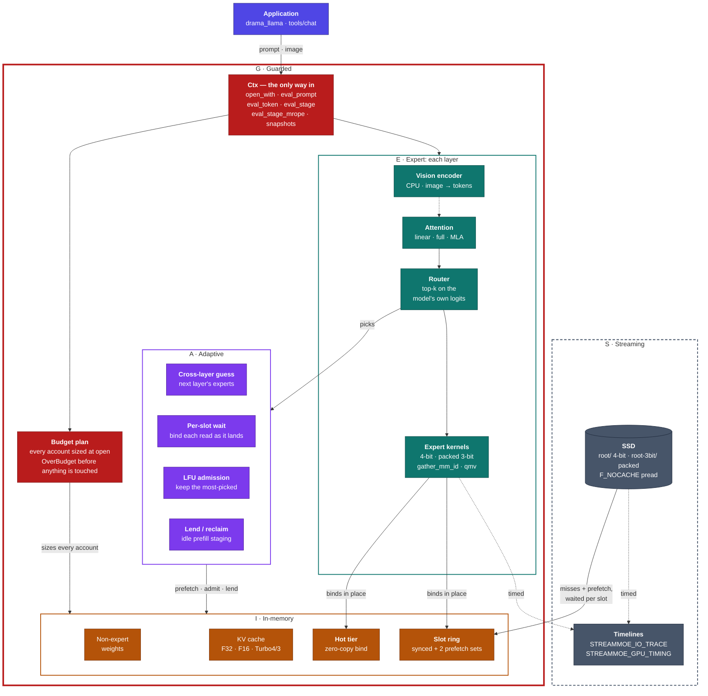

The red rim is the cap. Only the SSD sits outside it, and the only
traffic across the rim is expert bytes coming in through the slot ring.

### G · Guarded: memory planned, not hoped for

At open, streamoe sizes every account for the context you asked for —
`n_ctx`, KV format, request slots, checkpoints, host buffers — and the
expert hot tier takes exactly what is left. Expert reads use
`F_NOCACHE`, so the engine never grows the page cache and nothing else
on the machine loses its file cache. The plan for Qwen3.6-35B-A3B
(4-bit experts) under a 4 GiB cap (n_ctx 4096, F32 KV), as measured on
an M3 Pro:

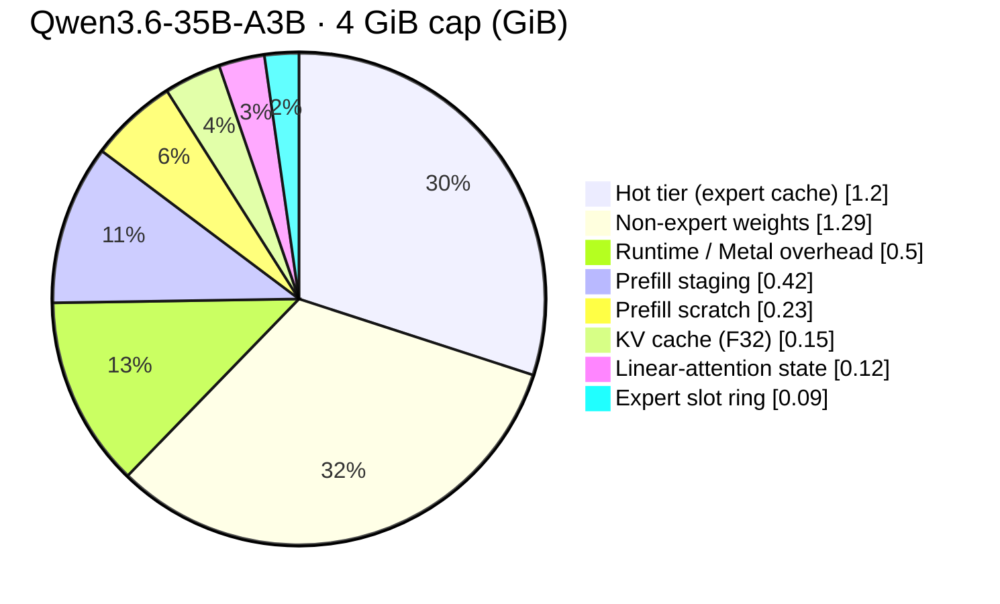

Measured footprint stays within 0.08 GiB of the plan; in every chat run
at 4, 5 and 7 GiB caps the peak stayed under the cap (3.7 / 4.7 /
6.7 GiB). A Turbo4 KV cache shrinks the KV slice to 0.02 GiB and the hot
tier grows by the difference; on models with large KV caches (OLMoE at
n_ctx 4096) that trade alone made decode 44% faster.

### I · In-memory: prefill staging serves decode

The prefill staging buffer (0.42 GiB, one slot per expert) is only
written while a prompt is read. During decode it would sit idle, so the
hot tier borrows it: 256 more expert slots without a byte over the
plan. The next prompt takes it back before its first chunk.

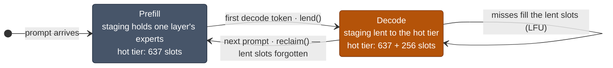

At a 4 GiB cap this lifts hot-tier hits from 51 / 22 / 42% to
58 / 34 / 54% on three chat prompts and cuts decode time per token by
10–12% on two of them (124 → 112 and 135 → 119 ms), flat on the third.
`STREAMMOE_HOT_LEND=0` turns it off.

### E · Expert: packed 3-bit

Decode is bound by bytes from the SSD, so the cheapest expert is the
smallest one that still gives the same answers. Packed 3-bit stores
8 codes in 3 bytes instead of 4; the kernels keep the 4-bit element
order and `w = scale · q + bias`, so packed and nibble-stored 3-bit
give bit-identical output.

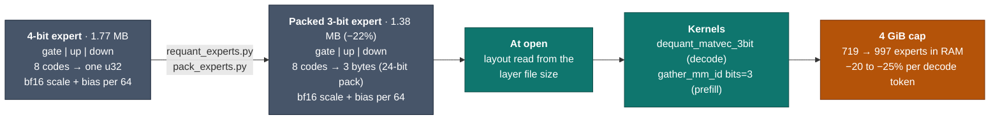

Against 4-bit: KL 0.048, the same top token 93% of the time, all 10
scored tasks right. 2-bit broke tool calls, maths, JSON and code, so it
is not offered.

### A + S · One layer of decode

Each layer hides as much of its I/O as it can behind GPU work:

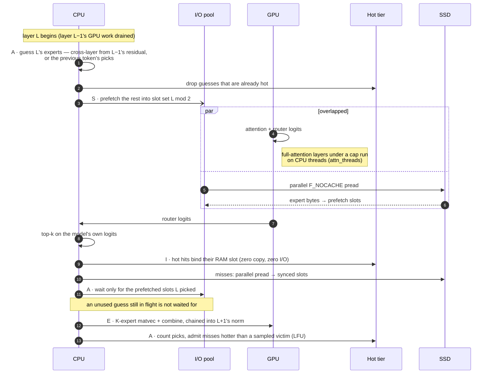

On Qwen3.6-35B-A3B (40 layers, 256 experts, 8 picked per token) the
cross-layer guess doubles prefetch hits over the previous-token guess
(63 → 127 per token) and, with 6 experts prefetched, cuts decode time
by about a fifth — with identical output. Guesses only decide *what to
read early*; routing always uses the model's own logits.

Where one decode token's ~120 ms goes at a 4 GiB cap (4-bit experts,
chat prompt, GPU timestamps and I/O counters):

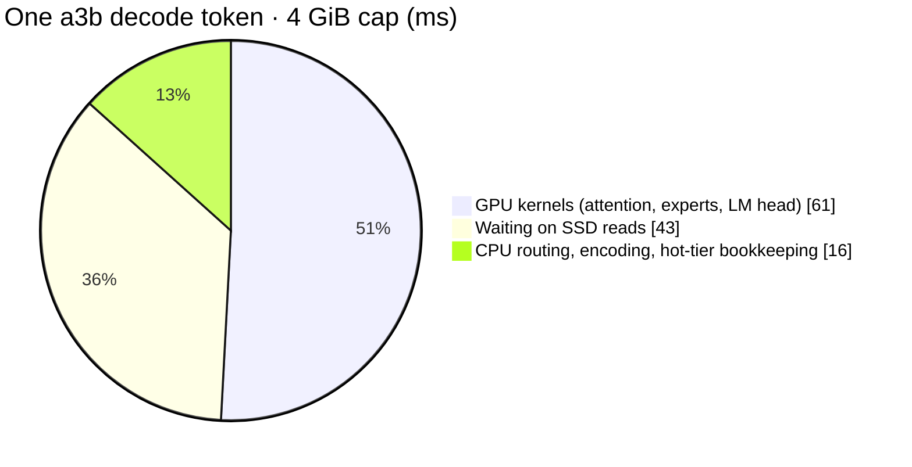

The CPU is ~95% idle (0.45 cores while decoding), so the levers are
fewer bytes from disk and fewer, longer GPU bursts — not more threads.

### S · Streaming: measured, not assumed

`STREAMMOE_IO_TRACE=<file>` records every expert read and the phase of
each layer; `tools/io_trace_report.py` turns it into disk busy / idle
time. Packed 3-bit at a 4 GiB cap, one chat answer (tracing adds ~15%,
so read it for proportions, not speed):

```text
prefill, 40 layer stages: 1474 ms, staging 971 ms, GPU between stages 503 ms; 72.7 experts/layer, 4.1 GB/s while staging
decode, 120 tokens: 113.3 ms/token, disk busy 51.8 ms, idle 61.6 ms; 137 reads, 180 MiB per token
  phase       wall ms  busy ms  idle ms
  attention      80.5     29.4     51.1
  misses         24.3     22.4      2.0
  dispatch        8.5      0.0      8.5
```

Prefill staging runs at the SSD's limit (~4.1–4.6 GB/s here), and the
disk's idle time in decode comes in ~1 ms pieces too short to fill with
more prefetch — the tries are in
[`docs/known-issues.md`](docs/known-issues.md). What lowers decode time
now is fewer bytes per token (packed 3-bit, a bigger cap) and less GPU
time.

### Mode A — one Mac, streaming

One machine runs every layer. A small hot tier serves the most-used
experts from RAM; the rest stream from disk on demand.

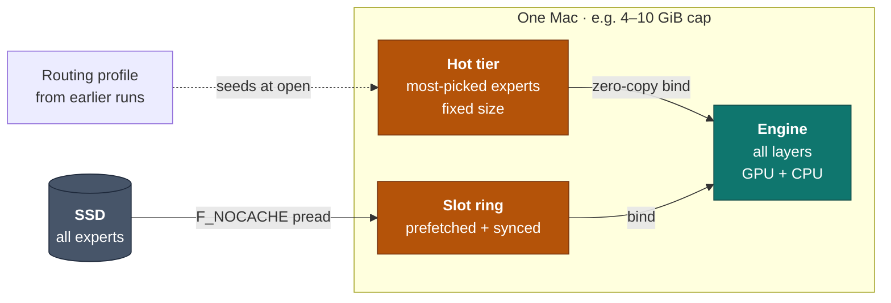

### Mode B — multiple Macs (separate repository)

**This repository handles mode A only.** Running one model across
several Macs — nodes, a coordinator, a layer-range planner, network
frames — is handled by a separate repository that builds on this
engine.

What stays here is the per-range engine API a pipeline needs:
`OpenConfig::layer_range` (open, plan and run only layers `a..b` inside
the cap), `Ctx::eval_stage` with f32 hidden states in and out, and
per-range snapshots. `crates/streammoe-net/` is the earlier prototype of
the pipeline (TCP loopback tested); it stays as a reference and is not
developed further here.

### Vision inside the shield

Qwen3.5 / 3.6 take images through a CPU vision encoder that lives inside
the same cap: its weights stream from disk per image, its 137 MiB of
buffers are part of the plan.

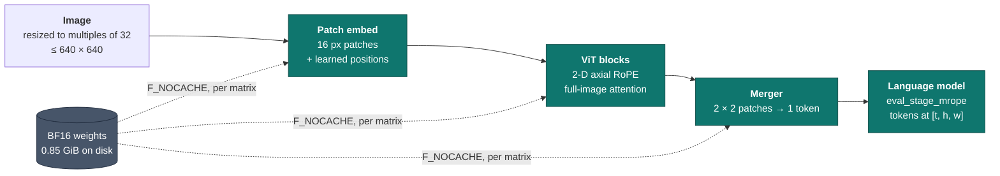

The encoder matches transformers exactly and mlx_vlm to 0.997; a
640 × 640 image becomes 400 tokens in ~3 s.

### Decode attention across cores

When the GPU attention fast path is not used — streaming or capped
runs, or a quantized `kv_format` — each decode step's attention runs
on the CPU. Its query heads are independent, so they are split across
a small thread pool (`attn_threads`, default 4). Every thread reads
the same KV cache (read-only, shared with the GPU) and writes only its
own heads' slice of the output, so no locks are needed and the result
is bit-identical to one thread.

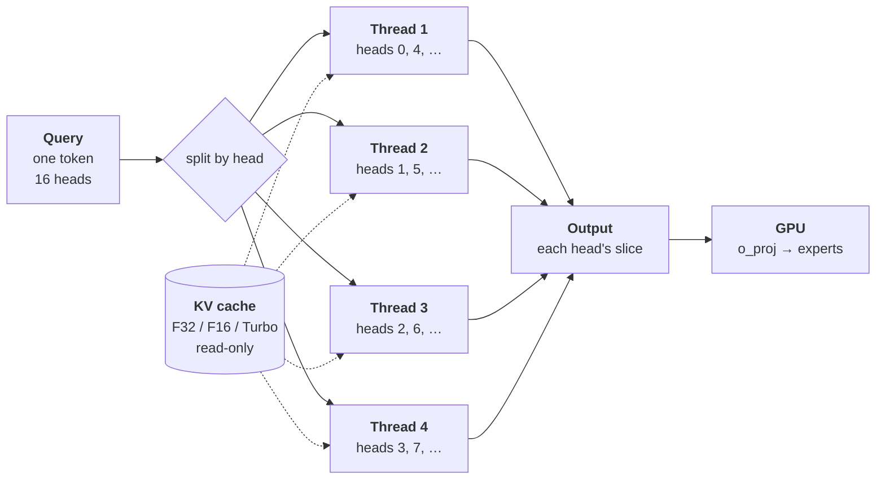

Per head, a thread scores the query against every cached key,
takes the softmax, and sums the weighted values. Turbo formats work
on the stored 4/3-bit codes directly, without decompressing the cache.
The pool picks up heads dynamically (work stealing), so the head
assignment above is illustrative. On OLMoE at 2.7k context this made
decode 55–58% faster; short contexts gain little, since attention is
then a small part of each step.

Details — memory accounts, the per-token data path, phases — are in
[`docs/fork-upgrade-plan.md`](docs/fork-upgrade-plan.md); the
motivation is in
[`docs/moeflux fork proposed changes.md`](docs/moeflux%20fork%20proposed%20changes.md).

### Repository layout

- `crates/streammoe/` — the engine. `RsCtx` (re-exported as `Ctx`) is
  the public surface. `src/riir/` holds `backend/{cpu,gpu}`, `attn/`,
  `moe/`, `io/` (expert streaming, prefetch), `snapshot/`
  (state save/load) and `variants.rs` (compile-time model shapes).
  Kernels in `shaders/shaders.metal` are embedded via `include_str!`
  and compiled at runtime.
- `crates/streammoe-metal/` — MLX-derived quantized GEMM and gather
  kernels.
- `crates/streammoe-net/` — earlier mode B prototype (frames,
  `streammoe-node`, `streammoe-coord`, range planner); kept as a reference,
  not developed further here — mode B lives in a separate repository.
- `scripts/` — model-prep pipeline (`extract_weights.py`,
  `export_vocab.py`, `export_tokenizer.py`), the test-host check
  (`check_test_host.sh`, run before any test phase), profiling
  (`profile_smoke.sh`, `profile_aggregate.py`) and `watch_run.sh`
  (samples a run's memory and CPU).
- `tools/` — model converters (`convert_olmoe.py`,
  `convert_cogito_v2.py`), a NumPy reference forward for OLMoE
  (`olmoe_ref.py`), an expert-cache simulator that replays routing
  traces (`sim_expert_cache.py`), `gen_expert_index.py`,
  `export_vision.py` (the Qwen3.5 / 3.6 vision tower for
  `riir::vision`), `chat/` (a local chat page for Qwen3.6-35B-A3B under
  a cap, with images and a live CPU / RAM bar), and
  `mlx_reference/` — the MLX reference diff harness
  (`crates/streammoe/tests/mlx_regression.rs` regenerates its goldens).
- `docs/` — design notes and the upgrade plan.

## Status

**Alpha** — `0.2.0-alpha.1` (unreleased changes since then in the changelog), based on moeflux `0.1.0-pre.4`. APIs may still change; changes are listed in [`CHANGELOG.md`](CHANGELOG.md).

| Area | State |
| --- | --- |
| Engine, Metal kernels, Qwen3.5-A17B / Qwen3.6-35B-A3B / Cogito-V2 variants | Exists |
| OLMoE-1B-7B variant (small test model: converter, NumPy reference, model tests under a cap) | Implemented — the model-level test bed on hosts without a3b weights |
| Expert streaming: mmap mode, pread + speculative prefetch, slot ring | Exists |
| Differential oracles (CPU vs Metal, batched vs per-token, MLX) | Exists |
| `OpenConfig`, `n_ctx`-sized KV, memory cap (plan, reserve at open, footprint checks) | Implemented — Phase 1; model-level tests pending |
| `F_NOCACHE` reads, fixed hot tier, routing profiles, expert-IO counters | Implemented — Phase 2; model-level tests pending |
| Layer-range execution (`layer_range`, `eval_stage`, f32 hidden in/out, per-range snapshots) | Implemented — Phase 3; model-level tests pending |
| Per-request state (`max_requests` pool, `admit_request` / `drop_request` / `eval_request`) | Implemented — Phase 4; model-level tests pending |
| `streammoe-net`: frames, `streammoe-node`, `streammoe-coord`, planner (TCP loopback) | Prototype — Phase 5; mode B continues in a separate repository |
| Streaming improvements: telemetry (`ExpertIoStats`, CSV), bounded I/O (`io_queue_depth`, `io_bytes_per_sec`), in-place coalesced prefill reads, cross-layer guesses, lookahead prefetch, `fast_experts_dir` disk tier, `prefetch_experts` (prefetch width) | Implemented — Phase 6; knobs default off except `prefetch_experts` = 4 under a cap (measured on OLMoE-1B-7B, +4–15% tok/s); a3b/a17b model tests pending |
| KV cache formats (`kv_format`: F32, F16, TurboQuant 4/3-bit; snapshot v4) | Implemented — F32 default; on OLMoE-1B-7B at a 3 GiB cap and n_ctx 4096, F16 / Turbo4 shrink KV 1.00 → 0.56 / 0.19 GiB (incl. prefill scratch) and decode +29% / +44% faster (the freed memory goes to the hot tier); answers correct in every format. MLA (Cogito) stays F32 |
| Decode attention threads (`attn_threads`, default 4) | Implemented — bit-identical output; on OLMoE at 2.7k context decode +55–58% tok/s (F32 and Turbo4) |
| Vision for Qwen3.5 / 3.6 (`riir::vision` CPU encoder, `eval_stage_mrope`, `tools/export_vision.py`) | Implemented — encoder matches transformers exactly and mlx_vlm to 0.997; whole pipeline checked layer by layer against MLX on a3b under a 4 GiB cap (encoder 137 MiB, ~1–3 s per image). Small printed text reads poorly, as it does in MLX |
| Decode I/O: per-slot prefetch waits, prefill staging lent to the hot tier (`STREAMMOE_HOT_LEND`), single-token `qmv` matvec kernel (`STREAMMOE_MATVEC_QMV`) | Implemented — on a3b at a 4 GiB cap decode 124 → 112 ms/tok on a short prompt; output unchanged |
| Packed 3-bit experts (`tools/requant_experts.py` → `tools/pack_experts.py`, `root-3bit/`; layout detected from the files), quality harness (`tools/chat` `quality` bin: KL, top-1, perplexity, scored tasks), `--precision 4\|3` in the chat page | Implemented — 1.38 MB per expert vs 1.77 (−22%); vs 4-bit: KL 0.048, top-1 agreement 93%, 10/10 tasks; a3b at a 4 GiB cap −20 to −25% per decode token and −29 to −34% time to first word. 2-bit fails 4 of 10 tasks |
| Router policy, per-expert precision | Planned — Phases 7–8 |

Build with exactly one model feature (`model-qwen3-6-35b-a3b`,
`model-qwen3-5-a17b`, `model-cogito-v2-671b`, `model-olmoe-1b-7b`):

```bash
cargo build --features model-qwen3-6-35b-a3b
# the whole workspace, streammoe-net included
cargo build --workspace --features model-qwen3-6-35b-a3b
```

Opening under a cap, with a compact KV cache:

```rust
use streammoe::{Ctx, KvFormat, OpenConfig};

let cfg = OpenConfig {
    n_ctx: 4096,
    mem_cap: Some(10 << 30),        // hard cap, bytes
    kv_format: KvFormat::Turbo4,    // F32 (default) | F16 | Turbo4 | Turbo3
    ..OpenConfig::default()         // hot tier takes what the plan leaves
};
let mut ctx = Ctx::open_with(&weights, &manifest, &vocab, &experts_root, false, &cfg)?;
```

`open_with` fails with `Error::OverBudget` if the plan does not fit the cap.

Tests: run `scripts/check_test_host.sh` first; it says which tier
(unit/kernel or model) this host can run. Fixed bugs, open issues and
traps are listed in [`docs/known-issues.md`](docs/known-issues.md).

## Roadmap

- **Faster time to first word.** Expert staging is ~74% of prefill and
  runs one layer at a time while the CPU sits ~95% idle; staging layer
  L+1 while the GPU computes layer L could cut it by a third.
- **Router policy and per-expert precision** (phases 7–8). After
  routing, a policy outside the engine decides per expert whether to
  run it at 4-bit, at 3-bit or skip it — trading quality for I/O one
  expert at a time instead of quantizing the whole model.
- **Fewer, longer GPU bursts.** GPU timestamps
  (`STREAMMOE_GPU_TIMING`) show decode kernels running 3–4× slower than
  in isolation: short GPU bursts between CPU routing and expert reads
  leave the GPU in a slow state. Merging per-layer command buffers is
  the next engine-side step.
- **More model families.** Qwen3-30B-A3B (`qwen3_moe`) as a new
  variant, then runtime variant dispatch instead of one compile-time
  feature per model.
- **Verification at full size.** The uncapped a3b oracle suites and
  a17b model runs need a host with ≥ 8 GiB to spare.

## Running Qwen3.6-35B-A3B on a small Mac

Measured on an M3 Pro (11 cores, 18 GB RAM, internal SSD) shared with
other services, with 5–7 GiB of RAM reclaimable. The model is 19.4 GB
at 4-bit; under a cap it streams experts from the SSD and keeps only
the hot ones in RAM, so it runs in 3–5 GiB.

### What it costs

| Resource | Cost |
| --- | --- |
| Disk | 20.4 GB download (`mlx-community/Qwen3.6-35B-A3B-4bit`) + 18.3 GB converted (1.3 GB non-expert weights, 16.9 GB packed experts) ≈ 39 GB. The MLX download can be deleted after conversion if you don't need `engine_op_diff` |
| RAM | Whatever you cap it at: a 3 GiB cap peaks at 2.65 GiB, 4 GiB at 3.65 GiB, 5 GiB at 4.65 GiB. Below ~3 GiB the fixed parts don't fit and `open_with` fails with `OverBudget` |
| Page cache | None from expert reads: under a cap they use `F_NOCACHE`, so the file cache other processes rely on is not evicted |
| CPU | 4 threads for decode attention (`attn_threads`), plus the I/O threads; the GPU does the rest |
| SSD | 380–600 MiB read per token (fewer with a bigger hot tier) |

Fixed parts of a 4 GiB plan (n_ctx 4096): weights 1.29 GiB, prefill
staging 0.42, runtime overhead 0.50, prefill scratch 0.23, linear-attention
state 0.12, expert slots 0.09, KV 0.02–0.15 (Turbo4 / F32). The hot tier
gets the rest: 1.2–1.3 GiB. Measured footprint stays 0.08 GiB within
the plan.

### Speed

Greedy decode, n_ctx 4096, 64 tokens, one batch of runs:

| Cap | Hot tier | Hot-tier hits | Decode, short prompt | Decode at 3.3k context | Prefill |
| --- | --- | --- | --- | --- | --- |
| 3 GiB | 0.30 GiB | 11% | 216 ms/tok (4.6 tok/s) | 246 ms/tok | 137 tok/s |
| 4 GiB | 1.31 GiB | 33% | 200 ms/tok (5.0 tok/s) | 225 ms/tok | 135 tok/s |
| 5 GiB | 2.31 GiB | 48% | 186 ms/tok (5.4 tok/s) | 224 ms/tok | 140 tok/s |

`attn_threads: 1` instead of 4 makes long-context decode 321 instead of
225 ms/tok. At decode's read sizes (1.7 MiB experts, 1–8 in flight)
this SSD peaks at ~4.4 GB/s, not its 6.7 GB/s sequential rating;
larger, sequential, partial or async (POSIX AIO, `dispatch_io`) reads
were measured and gain at most 5–8%, so decode is disk-bound and speed
comes from reading less: a bigger hot tier, better guesses, fewer bits. Answers are identical across caps, and match MLX:
argmax equal, top-20 overlap 20/20 with F32 KV and 19/20 with Turbo4
(the gate in `mlx_regression.rs` is 19). On a3b the KV cache is small
(10 full-attention layers, 2 KV heads), so F32 KV costs little and
Turbo4 gains nothing measurable.

The table uses the default prefetch (previous token's experts, 4 per
layer). On a3b, `prefetch_guess: PrefetchGuess::CrossLayer` — guess the
next layer's experts from the current hidden state, so their reads start
while the GPU is still busy — is faster with identical output (3 GiB cap,
repeated runs):

| Prefetch | Decode, short prompt | Decode at 3.3k context | I/O wait | Prefetch hits |
| --- | --- | --- | --- | --- |
| previous token, 4 (default) | 214–227 ms/tok (4.5 tok/s) | 267–295 ms/tok | 92–103 ms/tok | 63 / tok |
| cross-layer, 4 | 187–189 ms/tok (5.3 tok/s) | 229–243 ms/tok | 70 ms/tok | 127 / tok |
| cross-layer, 6 | **179 ms/tok (5.6 tok/s)** | 229 ms/tok | 68 ms/tok | 180 / tok |
| cross-layer, 8 | 192 ms/tok | 245 ms/tok | 75 ms/tok | 218 / tok |

More CPU threads do not help: `io_threads` 16 and `attn_threads` 8 match
the defaults. The rest of a token (~105 ms) is the CPU waiting on the
GPU's per-layer post-attention command buffer. On OLMoE-1B-7B the
cross-layer guess did not help.

Packed 3-bit experts (`--precision 3` in the chat page; see Setup) read
22% fewer bytes per expert, and the same memory holds 997 instead of
719 of them. Chat page at a 4 GiB cap, same prompts, greedy:

| Prompt | 4-bit | Packed 3-bit | First word, 4-bit → 3-bit |
| --- | --- | --- | --- |
| Photosynthesis (120 tokens) | 118 ms/tok (8.5 tok/s) | **89 ms/tok (11.2 tok/s)** | 1.57 → 1.11 s |
| JavaScript palindrome (74) | 146 ms/tok (6.8 tok/s) | **115 ms/tok (8.7 tok/s)** | 1.38 → 0.92 s |
| Hiking packing list (120) | 121 ms/tok (8.2 tok/s) | **97 ms/tok (10.3 tok/s)** | 1.36 → 0.90 s |

Quality against 4-bit: KL 0.048, the same top token 93% of the time,
perplexity 1.15 → 1.21, all 10 scored tasks right (JSON, tool calls,
arithmetic, code).

#### A bigger cap

More memory keeps more experts in the hot tier, so fewer reads go to
disk. Same three prompts (120 / 74 / 120 tokens), measured one run at
a time on 2026-10-26; the host was slower that day than in the table
above, so compare within this table:

| Experts | Cap | Photosynthesis | JavaScript palindrome | Hiking packing list | Hot-tier hits | Disk wait / tok |
| --- | --- | --- | --- | --- | --- | --- |
| 4-bit | 5 GiB | 116.5 ms (8.56 tok/s) | 165.0 ms (6.05 tok/s) | 125.4 ms (7.96 tok/s) | 70 / 45 / 64% | 28–69 ms |
| 4-bit | 7 GiB | 108.9 ms (9.16 tok/s) | 131.1 ms (7.61 tok/s) | 114.1 ms (8.75 tok/s) | 84 / 63 / 78% | 18–39 ms |
| Packed 3-bit | 5 GiB | 108.0 ms (9.24 tok/s) | 122.4 ms (8.16 tok/s) | 113.6 ms (8.79 tok/s) | 76 / 51 / 66% | 19–34 ms |
| Packed 3-bit | 7 GiB | 105.8 ms (9.43 tok/s) | 111.3 ms (8.96 tok/s) | 104.2 ms (9.58 tok/s) | 89 / 72 / 81% | 13–24 ms |

Two more GiB give 4-bit +7–26% tok/s and packed 3-bit +2–10%; the code
prompt, which spreads over the most experts, gains most. Peak memory
stayed under the cap (4.7 / 6.7 GiB). Packed 3-bit at 5 GiB is about as
fast as 4-bit at 7 GiB.

Larger caps, **estimated, not measured** (this 18 GB host can't spare
them). Each token spends ~87–92 ms outside the disk wait (forward time
minus disk wait at 7 GiB), and the disk wait goes to ~0 once every
expert fits: packed 3-bit's 13.1 GiB of experts fit at a ~16 GiB cap,
4-bit's 16.9 GiB at ~20 GiB (~2.7 GiB goes to everything else).

| Experts | Cap | Experts held | Disk wait / tok | Forward / tok | tok/s |
| --- | --- | --- | --- | --- | --- |
| Packed 3-bit | 15 GiB | ~94% | ~1–3 ms | ~88–95 ms | ~10.5–11.5 |
| Packed 3-bit | 20 GiB | all | ~0 | ~87–92 ms | ~11–11.5 |
| 4-bit | 15 GiB | ~73% | ~3–6 ms | ~93–98 ms | ~10–10.5 |
| 4-bit | 20 GiB | all | ~0 | ~89–92 ms | ~11 |

Past ~16 GiB packed 3-bit gains nothing more: the ceiling of ~11 tok/s
is GPU time per token, not the cap. A cap above the memory other
programs leave free makes the machine swap and is slower than a small
cap.

### Setup

```bash
scripts/check_test_host.sh               # CPU, RAM, headroom, disk

M=~/models/qwen3-6-35b-a3b
hf download mlx-community/Qwen3.6-35B-A3B-4bit --local-dir $M/mlx-4bit

python3 -I scripts/extract_weights.py --model $M/mlx-4bit --output $M/artifacts
python3 -I scripts/export_vocab.py $M/mlx-4bit/tokenizer.json $M/artifacts/vocab.bin
python3 -I tools/gen_expert_index.py --mlx-path $M/mlx-4bit --out $M/expert_index.json
python3 -I repack_experts.py --index $M/expert_index.json --output-dir $M/root/packed_experts
python3 -I tools/export_vision.py --model $M/mlx-4bit --out $M/artifacts   # optional: images
# optional: packed 3-bit experts (13 GB more disk; ~25% faster, slightly lower quality)
python3 -I tools/requant_experts.py $M/root --out 3=$M/root-3bit-nibble
python3 -I tools/pack_experts.py $M/root-3bit-nibble $M/root-3bit && rm -r $M/root-3bit-nibble
```

Conversion needs Python with NumPy, peaks under 0.3 GiB of RAM and
takes about 20 s once downloaded.

Then open it under a cap — `OpenConfig { mem_cap: Some(4 << 30),
n_ctx: 4096, max_checkpoints: 0, .. }` — or point the tests at it:

```bash
export STREAMMOE_SMOKE_ARTIFACTS=$M/artifacts STREAMMOE_SMOKE_ROOT=$M/root STREAMMOE_SMOKE_MLX=$M/mlx-4bit
```

`tests/mrope.rs` (multimodal positions) runs the model under a 3 GiB
cap. `tests/vision.rs` checks the vision encoder against reference
embeddings from transformers: set `STREAMMOE_VISION_DIR=$M/artifacts` and
`STREAMMOE_VISION_REF` to a folder of `<name>.rgb` (resized RGB bytes),
`<name>.emb` (f32 rows) and `meta.json` (`{name: {h, w}}`).

The a3b oracle suites (`--include-ignored`) open the model *without* a
cap and need ≥ 8 GiB reclaimable; `check_test_host.sh` says whether this
host qualifies. On a smaller host, run the model only under a cap.

### Chat page

`tools/chat` is a local chat page for trying the model yourself
(standalone crate; the engine gains no dependencies):

```bash
cd tools/chat
cargo run --release -- --cap-gib 4 --n-ctx 8192
# options: --kv f32|f16|turbo4, --attn-threads N, --guess cross|prev, --prefetch N,
#          --precision 4|3 (3 needs $M/root-3bit, see Setup)
# open http://127.0.0.1:8077
```

It listens on 127.0.0.1 only and keeps one conversation in the KV
cache, so each message prefills only the new text. The header shows
memory against the cap and the context used; each answer shows tok/s,
prefill speed, hot-tier hits and disk MiB per token. Thinking can be
toggled. An **Experts** selector in the header switches between
4-bit and packed 3-bit experts (the server restarts itself in ~2 s
and frees the old model first, so memory stays under the cap). It defaults to the cross-layer guess with 6 experts prefetched
(≈ 7 tok/s on a 115-token answer at a 4 GiB cap). Stop the server
(Ctrl-C) to give the memory back.

#### What it looks like

Recorded with headless Chrome against `tools/chat` on the M3 Pro
(shared with other services), `--cap-gib 4 --n-ctx 4096`, default
settings otherwise, temperature 0. Real time — the GIFs are not sped up.

**Text** — 6.7 tok/s, 3.66 GiB of the 4 GiB cap:

<p align="center"></p>

```text
58 tok · 6.7 tok/s · prompt 39 tok at 13 tok/s · hot-tier hits 46% · 329 MiB/tok from disk · avg CPU 57%
```

**Image** — 280 image tokens encoded and read in ~6 s, then 5.9 tok/s,
3.73 GiB peak. Each stage shows in the page as it happens:

| 1 · Vision encoder running | 2 · Answer streaming | 3 · Done, with the turn's stats |
| :---: | :---: | :---: |
| 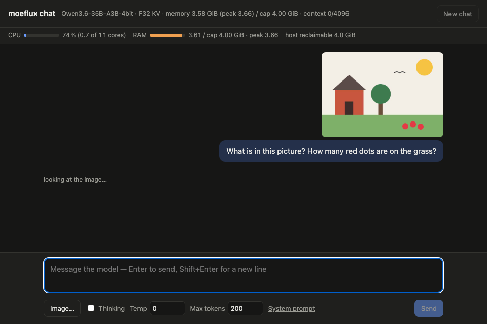 | 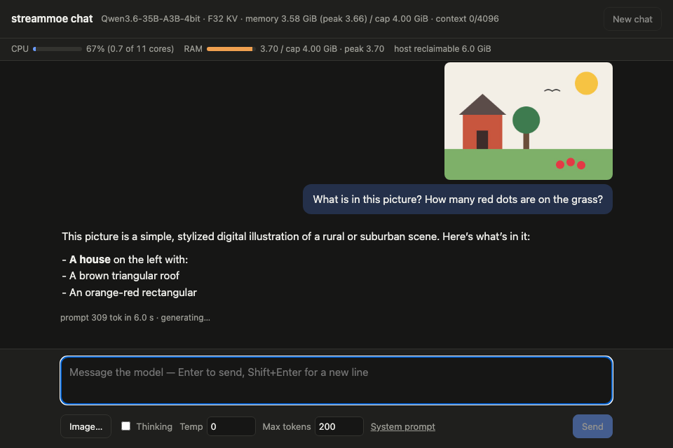 | 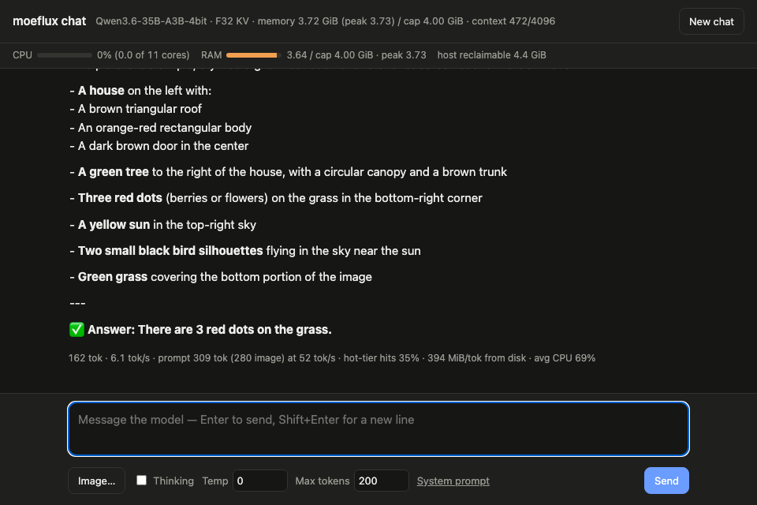 |

```text
162 tok · 5.9 tok/s · prompt 309 tok (280 image) at 52 tok/s · hot-tier hits 35% · 394 MiB/tok from disk · avg CPU 66%
```

The image is a drawing made for this demo (house, tree, sun, one bird
and three red dots). The model names the house, tree and sun, counts
the three dots correctly, and reads the single bird as two.

A bar under the header shows the process's CPU (as cores used), its
memory against the cap with the peak, and the host's reclaimable
memory, sampled every second; it keeps updating while an answer is
generated. Each answer also reports its average CPU.

**Images.** With `artifacts/vision_weights.bin` exported, an *Image…*
button appears (paste works too). The page resizes the picture so both
sides are multiples of 32 and the area is at most `--vision-max-pixels`
(default 640 × 640 = 400 image tokens); the CPU vision encoder
(`streammoe::riir::vision`, Accelerate GEMMs, `--vision-threads` default
4) turns it into embeddings, and the model reads them at their M-RoPE
positions (`Ctx::eval_stage_mrope`). The encoder streams its 0.85 GiB
of BF16 weights from disk for each image and keeps 137 MiB of buffers,
counted in the cap (`OpenConfig::host_buffers`). `--no-vision` turns it
off. Measured at a 4 GiB cap on the M3 Pro:

| Image | Image tokens | Encode | Prefill (whole turn) | Process memory | CPU (peak, whole run) |
| --- | ---: | ---: | ---: | ---: | ---: |
| 448 × 320 | 140 | 1.1 s | 5.3 s | 3.69 GiB | ≤ 2.1 cores |
| 512 × 512 | 256 | 1.9 s | 5.7 s | 3.69 GiB | ≤ 2.1 cores |
| 640 × 640 (cap) | 400 | 3.2 s | 5.3 s | 3.71 GiB | ≤ 2.1 cores |

Decode after an image runs at the usual speed. Scenes, colors, layout
and counting work (a 2 × 2 color grid, five dots, shapes and their
positions, a photo); reading small or short printed text is
unreliable. MLX makes the same mistakes when given the same image
embeddings (see `docs/known-issues.md`), so this comes from the model,
not the engine. Larger images help: "7780" read correctly at 640 × 320
and not at 512 × 256.

### Qwen3-30B-A3B

Qwen3-30B-A3B (the `qwen3_moe` architecture: 48 full-attention layers,
128 experts, top-8, no linear attention) is **not supported yet**: it
needs its own variant, likely closer to the OLMoE path than to the
Qwen3.6 one. Estimated from its shape, not measured: ~16 GB of 4-bit
experts at ~2.65 MB each, ~1 GB read per token with a cold hot tier —
about twice Qwen3.6-35B-A3B — and 192 KiB of F32 KV per token
(0.75 GiB at n_ctx 4096, ~0.1 GiB with Turbo4), so it would decode
slower than Qwen3.6-35B-A3B at the same cap and gain more from a
quantized `kv_format`.

## Provenance

streamoe is built on [mdegans/moeflux](https://github.com/mdegans/moeflux)
(history up to moeflux `0.1.0-pre.4`, commit `a36ae3b`, is upstream's
work). The revamp began on the author's fork,
[transybao1393/moeflux](https://github.com/transybao1393/moeflux), where
it was published under MIT up to commit `7d73350`; development
continues here. moeflux itself began as a fork of
[danveloper/flash-moe](https://github.com/danveloper/flash-moe) and
was rewritten in Rust to the point of being a distinct codebase. The host-side engine is
Rust on `metal-rs`; the original C/Objective-C functions served as
differential oracles during that rewrite. The Metal
streaming-experts kernels were authored by **Claude Opus 4.6**
(Anthropic) for flash-moe and carry over here. streamoe adds the
memory cap, streaming, pipeline, KV-format, vision and tooling work
described above on top of that. The math is the same linear
algebra every inference engine runs; what streamoe contributes is the
systems design around it — the memory contract, the tiering, the
speculation that never changes the output, and the pipeline.

## License

streamoe is licensed in two parts; [`NOTICE`](NOTICE) has the exact
boundary.

- **MIT** ([`LICENSE-MIT`](LICENSE-MIT)) — everything in the repository
  as of commit `7d73350`: the flash-moe and moeflux code it was built
  on, and the streamoe work published under MIT up to that commit on
  [transybao1393/moeflux](https://github.com/transybao1393/moeflux). Also
  `crates/streammoe-metal/` (vendored MLX and llama.cpp kernels; see its
  own `NOTICE`) and `paper/`. Check out `7d73350` for the MIT-only code.
- **PolyForm Noncommercial 1.0.0** ([`LICENSE.md`](LICENSE.md)) — every change
  after `7d73350`, starting with vision input, and all future work.

**Free:** personal study, research, experiments, hobby projects, and
use by schools, universities, public research organizations, charities
and government bodies.

**Commercial use** of the current tree — inside a product or service,
or for work done for a business — needs a commercial license. Contact
[@transybao1393](https://github.com/transybao1393).

streamoe is source-available, not open source in the OSI sense. See
also [`CONTRIBUTORS.md`](CONTRIBUTORS.md).

## Acknowledgements

- **@danveloper** — for building the thing the hard way, writing it
  up, and publishing everything openly. moeflux started as flash-moe
  and git history reflects that.
- **@mdegans** — for moeflux, the Rust rewrite streamoe builds on.
- **[transybao1393/moeflux](https://github.com/transybao1393/moeflux)**
  — the author's moeflux fork, where the revamp began: the memory cap,
  `F_NOCACHE` streaming and hot tier, the layer-range pipeline, KV
  formats, decode attention threads and the chat page were built and
  published there under MIT (up to commit `7d73350`) before development
  moved to streamoe.
- **Claude Opus 4.6** — for the Metal streaming-experts kernels and
  the architecture that made all of this run.
- **Anthropic** — for making Claude available to do work like this in
  the first place.
