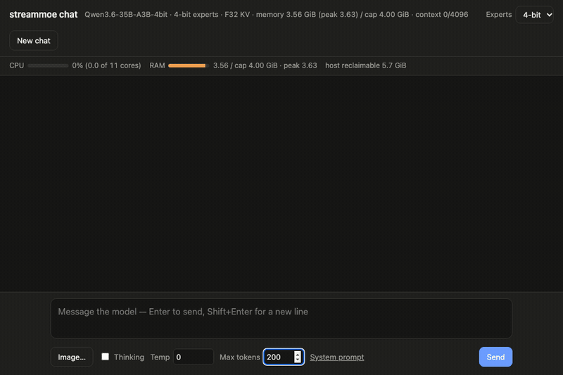

# streamoe

**Big models. Small machines. Hard limits.**

streamoe is a pure-Rust Mixture-of-Experts inference engine for Apple
Silicon, built on one conviction: *the size of a model should not
decide which machine can run it — your memory budget should.* You set a
cap; streamoe plans every byte at open, streams experts from SSD
through a hot tier it manages itself, and keeps to that plan. The
design is called **AEGIS** — Adaptive · Expert · Guarded · In-memory ·
Streaming; see [Architecture](#architecture--aegis).

Today that means a 35-billion-parameter vision-language model —
Qwen3.6-35B-A3B, 19 GiB at 4-bit — answering questions about images
in **4 GiB of RAM** on a shared laptop, at **10–11 tokens per second**
(8–14 from a 3 to a 6 GiB cap; [Speed](#speed)), making the same
greedy choices as the MLX reference.

<p align="center">
  
  <br>
  <sub><code>tools/chat</code> on an M3 Pro with other apps running · 4-bit experts, 4 GiB cap · an image turn (309-token prompt) ·
  recorded in real time, not sped up · <b>9.6 tok/s</b> · 3.68 GiB peak · <a href="docs/chat-page.md">more</a></sub>
</p>

> **Lineage.** streamoe grew out of
> [moeflux](https://github.com/mdegans/moeflux), which grew out of
> [flash-moe](https://github.com/danveloper/flash-moe); the revamp
> started on the author's moeflux fork,
> [transybao1393/moeflux](https://github.com/transybao1393/moeflux).
> It keeps their
> engine and Metal kernels and rebuilds everything around them: a
> strict memory contract, cache-free expert streaming with a
> frequency-managed hot tier, layer-range execution, multiple
> requests in flight, compact KV caches and vision input. Git
> history keeps the whole lineage; see [Provenance](#provenance).
>
> **License.** streamoe is source-available: free for personal,
> academic and other noncommercial use; commercial use needs a license
> from the author. Code inherited from moeflux and flash-moe stays MIT.
> See [License](#license).

## Direction

Inference engines usually ask *"how much memory does this model need?"*
streamoe asks instead: *"here is the memory you may use — make the
model fit, and make it fast."*

- **Memory is a contract, not an estimate.** Weights, KV, scratch,
  checkpoints, driver overhead, the vision encoder — and the page
  cache the engine would otherwise cause — are planned and touched at
  open. If the plan does not fit, `open` fails before anything else on
  the machine is affected.
- **Disk is a tier, not a fallback.** `F_NOCACHE` streaming, a hot
  tier and speculative prefetch let a model 4–6× larger than its
  budget decode at 8–14 tokens per second.
- **Speculation never changes the math.** Guesses only decide *what to
  read early*; routing uses the model's own logits, and output is
  identical across caps.
- **Every claim is measured.** Correctness is checked against MLX and
  transformers, CPU against Metal, batched against per-token; ideas
  that did not pay off are written down in
  [`docs/known-issues.md`](docs/known-issues.md).

This repository is the single-node engine (one Mac runs every layer).
Splitting a model across several Macs lives in a separate repository
built on this engine's `layer_range` / `eval_stage` API.

## Architecture — AEGIS

An aegis is a shield. The memory cap is its rim: nothing inside
crosses it, nothing outside it is disturbed, and everything inside
works to run a model several times larger than the shield — fast.

| | Principle | What does it |
| --- | --- | --- |
| **A** · Adaptive | Fit the work to the cap and to what the model is doing right now | cross-layer expert guesses, per-slot prefetch waits, a hot tier that forgets old topics in ~13 tokens, lending idle buffers |
| **E** · Expert | Make every routed expert cheap to read and to run | packed 3-bit experts (−22% bytes), fused gather kernels, `qmv` for single-token matvecs |
| **G** · Guarded | Memory is a contract, not an estimate | the budget plan at open (`OverBudget` before anything is touched), `F_NOCACHE`, vision and KV inside the plan |
| **I** · In-memory | Bytes already in RAM do as much work as they can | the hot tier (zero-copy bind), the slot ring, compact KV (F16, Turbo4/3), prefill buffers lent to decode |
| **S** · Streaming | Disk is a tier, and its time is measured | parallel `F_NOCACHE` pread overlapped with GPU work, I/O and GPU timelines |

<p align="center">
  
</p>

Each decode step: attention reads the always-resident weights and the
KV cache; the router picks 8 of 256 experts; hot experts bind straight
from RAM while the rest stream from the SSD into a slot ring, and the
next layer's experts are guessed and prefetched meanwhile. The memory
plan, the hot tier, packed 3-bit experts, vision and the per-layer
timeline are explained in [`docs/architecture.md`](docs/architecture.md).

## Status

**Beta** — `0.2.0-beta.3`, based on moeflux `0.1.0-pre.4`. APIs may
still change before 0.2.0; changes are listed in
[`CHANGELOG.md`](CHANGELOG.md).

| Area | State |
| --- | --- |
| Memory cap, `F_NOCACHE` streaming, hot tier, prefetch | Implemented, tested on Qwen3.6-35B-A3B under a 4 GiB cap |
| Layer-range execution, per-request state, snapshots | Implemented, tested |
| KV formats (F32, F16, Turbo4/3), decode attention threads | Implemented, tested |
| Vision for Qwen3.5 / 3.6 | Implemented; matches transformers (cosine 1.000000) |
| Packed 3-bit experts | Implemented; KL 0.048 vs 4-bit, 10/10 scored tasks |
| Several tokens per pass (parallel requests, speculative checks) | Implemented; 1.3× throughput with 4 requests |
| Models | Qwen3.6-35B-A3B tested; Qwen3.5-A17B, Cogito-V2, OLMoE-1B-7B variants build |
| Router policy, per-expert precision | Planned |

The full table, how each part was tested, and the last test run are in
[`docs/status.md`](docs/status.md); open issues and traps in
[`docs/known-issues.md`](docs/known-issues.md). Run
`scripts/check_test_host.sh` before any tests.

## Running Qwen3.6-35B-A3B on a small Mac

The model is 19 GiB at 4-bit. Under a cap streamoe keeps only the
hottest experts in RAM and streams the rest from the SSD, so it runs in
3–6 GiB.

### Speed

*Standard setup: M3 Pro (18 GB RAM, shared with other apps), n_ctx
4096, F32 KV, greedy, three chat prompts, mean of 2 runs, 2026-10-28
build ([details](docs/benchmarks.md#test-setup)).* Decode tok/s, with
the 2026-10-26 build's figure for comparison:

| Cap | 4-bit experts | Packed 3-bit experts | Peak memory |
| --- | --- | --- | --- |
| 3 GiB | **8.3** (was 6.5) | **9.4** (was 7.5) | 2.6 GiB |
| 4 GiB | **10.2** (was 7.4) | **11.4** (was 8.1) | 3.6 GiB |
| 5 GiB | **11.5** (was 7.9) | **13.1** (was 8.6) | 4.6 GiB |
| 6 GiB | **12.8** (was 8.3) | **14.2** (was 9.2) | 5.6 GiB |

- Output is identical across caps; with 4-bit experts it matches the
  MLX reference. Packed 3-bit is 11–14% faster for a small quality
  cost (KL 0.048, same top token 93% of the time).
- The gain over 2026-10-26 comes from the hot tier: forgetting old
  topics in ~13 tokens (+20%) and borrowing idle prefill memory
  (+16%).
- **Against MLX** on the same Mac, same 4-bit files and prompt: MLX
  needs 18.6 GB for the model (more than this 18 GB Mac can spare with
  other apps open), filled 15.5 of 16 GB of swap and produced about
  3 tokens in 10 minutes before it was stopped; streamoe decodes the
  same prompt at 10.7 tok/s in 3.6 GiB
  ([details](docs/benchmarks.md#compared-with-mlx)).
- **Against llama.cpp** with mmap, same Mac: at equal memory (8 GiB)
  streamoe is 79% faster (14.1 vs 7.9 tok/s); llama.cpp holds about
  10.5 GiB of the model file in page cache in every setting, and only
  matches streamoe's 3 GiB cap
  ([below](#against-llamacpp-mmap)).
- Per-prompt numbers, what each feature is worth, multi-token passes
  and where a token's time goes: [`docs/benchmarks.md`](docs/benchmarks.md).

#### From an external SSD

*Setup: standard, except: model on a Kingston NV3 500 GB (QLC) in a
USB4 enclosure (2.3–2.6 GB/s uncached reads), 4-bit experts, caps 7
and 9 GiB run alternately back to back (7, 9, 7, 9), 2026-10-30, same
engine build.* Decode tok/s over all three prompts, with each run in
brackets:

| Cap | tok/s, all | Hot-tier hits | Expert reads from disk / token | Disk wait / token | Peak memory |
| --- | --- | --- | --- | --- | --- |
| 7 GiB | **10.2** (10.6, 9.9) | 85% | 24 | 40 ms | 6.6 GiB |
| 9 GiB | **11.2** (11.7, 10.7) | 90% | 18 | 31 ms | 8.7 GiB |

- The 2 GiB larger cap is worth ~10%. The GPU's work per token is the
  same at both caps (~39 ms in the Metal timeline); the larger hot tier
  saves ~6 expert reads per token, so the GPU waits less for the drive.
- Compare caps within this table, not with the one above. On the same
  day a 7 GiB run from the internal SSD gave 9.5 tok/s with half the
  disk wait (20 ms per token for about as many reads, 25), so that day's
  differences outside the disk were larger than the external drive's
  cost.
- Per-prompt numbers: [`docs/benchmarks.md`](docs/benchmarks.md#from-an-external-ssd).

#### Against llama.cpp (mmap)

*Setup: standard, internal SSD, 4-bit experts, 2026-10-30 19:22–20:13,
same engine build. llama.cpp b11988 (official macOS release) with
`unsloth/Qwen3.6-35B-A3B-GGUF` `UD-Q4_K_S` (19.46 GiB):
`llama-server -c 4096 -np 1 --reasoning off --no-warmup --no-repack
-ngl 99`, mmap on (its default), F16 KV, 5 threads. The GGUF is dropped
from the page cache before every llama.cpp run, so each starts cold.
Same three prompts, greedy, thinking off, a fresh server per run. Each
llama.cpp setting runs back to back with the streamoe cap that pins
about the same memory, plus an 8 GiB cap for about the memory
`--cpu-moe` ends up holding; mean of 2 runs (3 for `--cpu-moe`).*
tok/s per prompt (Photosynthesis / JavaScript / Hiking):

| Engine, setting | tok/s per prompt | tok/s, all (each run) | First word | Model file in page cache | Wired memory | CPU cores | Disk MiB / token |
| --- | --- | --- | --- | --- | --- | --- | --- |
| llama.cpp `--cpu-moe` | 9.5 / 5.6 / 8.6 | **7.9** (8.0, 7.9, 7.8) | 4.5–6.5 s | 10.5 GiB | +2.4 GiB | 1.8 | 38 |
| streamoe, 3 GiB cap | 8.2 / 7.0 / 8.4 | **7.9** (7.9, 7.8) | 1.4–1.7 s | 0 | 2.65 GiB peak | 0.4 | 315 |
| streamoe, 8 GiB cap | 15.1 / 12.2 / 15.0 | **14.1** (14.1, 14.1) | 1.1–1.6 s | 0 | 7.64 GiB peak | 0.7 | 78 |
| llama.cpp `--n-cpu-moe 36` | 9.5 / 5.7 / 8.8 | **8.0** (8.2, 7.8) | 4.7–5.8 s | 10.6 GiB | +4.6 GiB | 1.7 | 38 |
| streamoe, 4 GiB cap | 10.3 / 8.5 / 10.7 | **9.8** (9.7, 10.0) | 1.4–1.7 s | 0 | 3.65 GiB peak | 0.5 | 212 |
| llama.cpp `--n-cpu-moe 34` | 9.8 / 5.7 / 8.8 | **8.1** (8.2, 8.0) | 4.9–5.4 s | 10.5 GiB | +5.3 GiB | 1.6 | 39 |
| streamoe, 5 GiB cap | 12.1 / 9.4 / 12.3 | **11.3** (11.4, 11.2) | 1.3–1.6 s | 0 | 4.62 GiB peak | 0.6 | 154 |
| llama.cpp `--n-cpu-moe 32` | 9.2 / 5.3 / 8.4 | **7.6** (7.7, 7.5) | 4.8–6.8 s | 10.4 GiB | +6.0 GiB | 1.5 | 43 |
| streamoe, 6 GiB cap | 13.6 / 10.7 / 13.2 | **12.5** (12.7, 12.3) | 1.3–1.5 s | 0 | 5.62 GiB peak | 0.6 | 116 |
| llama.cpp, all on GPU (no expert override) | — | **no token**: stopped after 37 s with under 1 GiB of host memory free | — | 10.4 GiB | — | — | — |

- **At equal memory streamoe is 79% faster**: at an 8 GiB cap it
  decodes 14.1 tok/s in 7.64 GiB, while llama.cpp `--cpu-moe` decodes
  7.9 holding 10.5 GiB of the model file in page cache plus 2.4 GiB
  wired. At a 3 GiB cap the two are level (7.9 tok/s), with streamoe in
  a quarter of the memory.
- **Against each matching setting** streamoe is level at 3 GiB and
  23%, 39% and 64% faster at 4, 5 and 6 GiB, with no page cache,
  a quarter to under half the CPU, and a first word 3–5× sooner.
- **llama.cpp's memory is set by the machine, not the flag**: in every
  setting its page cache grew until about 10.5 GiB of the 19.5 GiB file
  was in RAM, whatever was free; `--n-cpu-moe` only moves more of it
  into wired memory (the GPU-side weights are mapped from the same
  file, so the two columns overlap). Its speed stays at 7.6–8.1 tok/s.
- **llama.cpp reads 2–8× less from disk per token**: its 10.5 GiB
  page cache keeps experts that streamoe, with `F_NOCACHE` and a hot
  tier inside the cap, reads again. With 8 GiB, streamoe still reads
  twice as much per token (78 vs 38 MiB) and is still faster.
- **All on the GPU, llama.cpp never produced a token**: its 19.5 GiB of
  weights don't fit, so macOS keeps evicting and re-reading the mapped
  file. The memory guard stopped it after 37 s, before the first
  token, with 10.4 GiB of the file already in page cache.
- **The streamoe rows read 2–5% below the Speed table above** at the
  same cap (4 GiB: 9.8 here, 10.2 there). Same engine build and
  settings; the Speed table was measured on 2026-10-28 and these rows
  on 2026-10-30, so the gap is the host on different days. Compare
  rows within each table.
- `--no-warmup` and `--no-repack` keep llama.cpp a true mmap run: its
  warm-up activates every expert and pulls most of the file into
  memory, and repacking copies the CPU-side experts into private
  memory. Without them both first attempts pushed this host into swap.
- How it was measured, every second during each run: model file in page
  cache is the GGUF's resident size from `mincore` (exact; the file is
  evicted with `msync(MS_INVALIDATE)` before each llama.cpp run, no
  `sudo` needed); wired memory is the rise in wired pages for llama.cpp
  and the engine's own peak for streamoe; disk MiB / token is internal
  SSD traffic during decode (first token to last) divided by the
  tokens decoded, for both engines. Answers are not compared token by
  token: the quantizations differ.

### What it costs

| Resource | Cost |
| --- | --- |
| Disk | ~38 GiB: the 19 GiB download plus 19 GiB converted (the download can be deleted afterwards); packed 3-bit experts add 13.1 GiB |
| RAM | Whatever you cap it at, from ~3 GiB up |
| Page cache | None from expert reads (`F_NOCACHE`) |
| CPU | ~0.6 cores while decoding; the GPU does the rest |

### Setup

```bash
scripts/check_test_host.sh               # CPU, RAM, headroom, disk

M=~/models/qwen3-6-35b-a3b
hf download mlx-community/Qwen3.6-35B-A3B-4bit --local-dir $M/mlx-4bit

python3 -I scripts/extract_weights.py --model $M/mlx-4bit --output $M/artifacts
python3 -I scripts/export_vocab.py $M/mlx-4bit/tokenizer.json $M/artifacts/vocab.bin
python3 -I tools/gen_expert_index.py --mlx-path $M/mlx-4bit --out $M/expert_index.json
python3 -I scripts/repack_experts.py --index $M/expert_index.json --output-dir $M/root/packed_experts
python3 -I tools/export_vision.py --model $M/mlx-4bit --out $M/artifacts   # optional: images
# optional: packed 3-bit experts (13.1 GiB more disk; 11–14% faster, slightly lower quality)
python3 -I tools/requant_experts.py $M/root --out 3=$M/root-3bit-nibble
python3 -I tools/pack_experts.py $M/root-3bit-nibble $M/root-3bit && rm -r $M/root-3bit-nibble
```

Conversion needs Python with NumPy, peaks under 0.3 GiB of RAM and
takes about 20 s once downloaded.

Then open it under a cap — `OpenConfig { mem_cap: Some(4 << 30),
n_ctx: 4096, max_checkpoints: 0, .. }` — or point the tests at it:

```bash
export STREAMMOE_SMOKE_ARTIFACTS=$M/artifacts STREAMMOE_SMOKE_ROOT=$M/root STREAMMOE_SMOKE_MLX=$M/mlx-4bit
```

`tests/mrope.rs` (multimodal positions) runs the model under a 3 GiB
cap. `tests/vision.rs` checks the vision encoder against reference
embeddings from transformers: set `STREAMMOE_VISION_DIR=$M/artifacts` and
`STREAMMOE_VISION_REF` to a folder of `<name>.rgb` (resized RGB bytes),
`<name>.emb` (f32 rows) and `meta.json` (`{name: {h, w}}`).

The a3b oracle suites (`--include-ignored`) open the model *without* a
cap and need ≥ 8 GiB reclaimable; `check_test_host.sh` says whether this
host qualifies. On a smaller host, run the model only under a cap.

### Chat page

```bash
cd tools/chat && cargo run --release -- --cap-gib 4 --n-ctx 8192
# open http://127.0.0.1:8077
```

A local page (127.0.0.1 only) with images, a 4-bit / packed 3-bit
switch, and live CPU and memory against the cap:

<p align="center"></p>

Options, stills of an image turn and what the vision side can and
can't read: [`docs/chat-page.md`](docs/chat-page.md). Qwen3-30B-A3B
is not supported yet (it needs its own variant).

## Roadmap

- **Faster time to first word**: stage layer L+1's experts while the
  GPU computes layer L (staging is ~74% of prefill).
- **Router policy and per-expert precision**: per expert, 4-bit, 3-bit
  or skip, chosen at run time.
- **Fewer, longer GPU bursts**: more than half of each token is GPU
  and CPU work that a bigger cap doesn't remove.
- **More model families**: Qwen3-30B-A3B, then runtime variant
  dispatch.

## Provenance

streamoe is built on [mdegans/moeflux](https://github.com/mdegans/moeflux)
(history up to moeflux `0.1.0-pre.4`, commit `a36ae3b`, is upstream's
work), itself a Rust rewrite of
[danveloper/flash-moe](https://github.com/danveloper/flash-moe). The
revamp began on the author's fork,
[transybao1393/moeflux](https://github.com/transybao1393/moeflux),
published under MIT up to commit `7d73350`; development continues
here. The Metal streaming-experts kernels were authored by **Claude
Opus 4.6** (Anthropic) for flash-moe and carry over. streamoe adds the
memory contract, the tiering, the speculation that never changes the
output, vision and the tooling around them.

## License

streamoe is licensed in two parts; [`NOTICE`](NOTICE) has the exact
boundary.

- **MIT** ([`LICENSE-MIT`](LICENSE-MIT)) — everything in the repository
  as of commit `7d73350`: the flash-moe and moeflux code it was built
  on, and the streamoe work published under MIT up to that commit on
  [transybao1393/moeflux](https://github.com/transybao1393/moeflux). Also
  `crates/streammoe-metal/` (vendored MLX and llama.cpp kernels; see its
  own `NOTICE`). Check out `7d73350` for the MIT-only code.
- **PolyForm Noncommercial 1.0.0** ([`LICENSE.md`](LICENSE.md)) — every change
  after `7d73350`, starting with vision input, and all future work.

**Free:** personal study, research, experiments, hobby projects, and
use by schools, universities, public research organizations, charities
and government bodies.

**Commercial use** of the current tree — inside a product or service,
or for work done for a business — needs a commercial license. Contact
[@transybao1393](https://github.com/transybao1393).

streamoe is source-available, not open source in the OSI sense. See
also [`CONTRIBUTORS.md`](CONTRIBUTORS.md).

## Acknowledgements

- **@danveloper** — for building the thing the hard way, writing it
  up, and publishing everything openly. moeflux started as flash-moe
  and git history reflects that.
- **@mdegans** — for moeflux, the Rust rewrite streamoe builds on.
- **[transybao1393/moeflux](https://github.com/transybao1393/moeflux)**
  — the author's moeflux fork, where the revamp began: the memory cap,
  `F_NOCACHE` streaming and hot tier, the layer-range pipeline, KV
  formats, decode attention threads and the chat page were built and
  published there under MIT (up to commit `7d73350`) before development
  moved to streamoe.
- **Claude Opus 4.6** — for the Metal streaming-experts kernels and
  the architecture that made all of this run.
- **Anthropic** — for making Claude available to do work like this in
  the first place.
