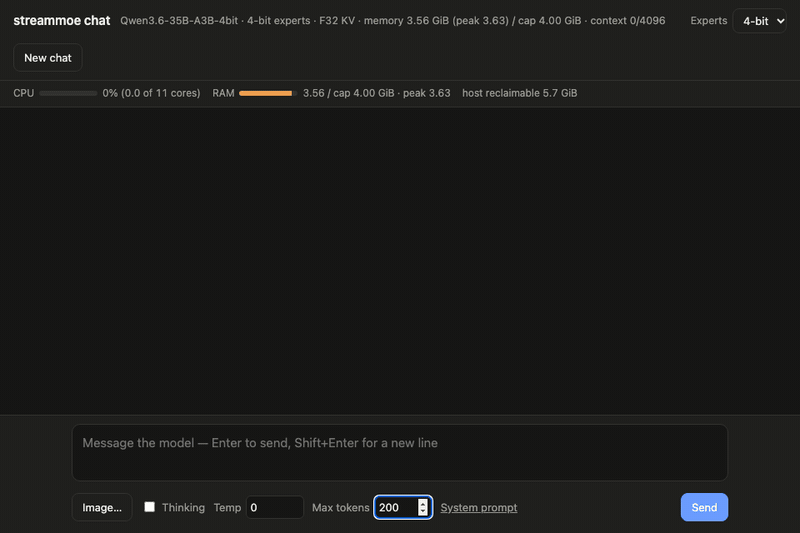

# streamoe

**Big models. Small machines. Hard limits.**

streamoe is a pure-Rust Mixture-of-Experts inference engine for Apple
Silicon, built on one conviction: *the size of a model should not
decide which machine can run it — your memory budget should.* You set a
cap; streamoe plans every byte at open, streams experts from SSD
through a hot tier it manages itself, and keeps to that plan. The
design is called **AEGIS** — Adaptive · Expert · Guarded · In-memory ·
Streaming; see [Architecture](#architecture--aegis).

Today that means a 35-billion-parameter vision-language model —
Qwen3.6-35B-A3B, 19 GiB at 4-bit — answering questions about images
in **4 GiB of RAM** on a shared laptop, at **10–11 tokens per second**
(8–14 from a 3 to a 6 GiB cap; [Speed](#speed)), making the same
greedy choices as the MLX reference.

<p align="center">
  
  <br>
  <sub><code>tools/chat</code> on an M3 Pro with other apps running · 4-bit experts, 4 GiB cap · an image turn (309-token prompt) ·
  recorded in real time, not sped up · <b>9.6 tok/s</b> · 3.68 GiB peak · <a href="docs/chat-page.md">more</a></sub>
</p>

> **Lineage.** streamoe grew out of
> [moeflux](https://github.com/mdegans/moeflux), which grew out of
> [flash-moe](https://github.com/danveloper/flash-moe); the revamp
> started on the author's moeflux fork,
> [transybao1393/moeflux](https://github.com/transybao1393/moeflux).
> It keeps their
> engine and Metal kernels and rebuilds everything around them: a
> strict memory contract, cache-free expert streaming with a
> frequency-managed hot tier, layer-range execution, multiple
> requests in flight, compact KV caches and vision input. Git
> history keeps the whole lineage; see [Provenance](#provenance).
>
> **License.** streamoe is source-available: free for personal,
> academic and other noncommercial use; commercial use needs a license
> from the author. Code inherited from moeflux and flash-moe stays MIT.
> See [License](#license).

## Direction

Inference engines usually ask *"how much memory does this model need?"*
streamoe asks instead: *"here is the memory you may use — make the
model fit, and make it fast."*

- **Memory is a contract, not an estimate.** Weights, KV, scratch,
  checkpoints, driver overhead, the vision encoder — and the page
  cache the engine would otherwise cause — are planned and touched at
  open. If the plan does not fit, `open` fails before anything else on
  the machine is affected.
- **Disk is a tier, not a fallback.** `F_NOCACHE` streaming, a hot
  tier and speculative prefetch let a model 4–6× larger than its
  budget decode at 8–14 tokens per second.
- **Speculation never changes the math.** Guesses only decide *what to
  read early*; routing uses the model's own logits, and output is
  identical across caps.
- **Every claim is measured.** Correctness is checked against MLX and
  transformers, CPU against Metal, batched against per-token; ideas
  that did not pay off are written down in
  [`docs/known-issues.md`](docs/known-issues.md).

This repository is the single-node engine (one Mac runs every layer).
Splitting a model across several Macs lives in a separate repository
built on this engine's `layer_range` / `eval_stage` API.

## Architecture — AEGIS

An aegis is a shield. The memory cap is its rim: nothing inside
crosses it, nothing outside it is disturbed, and everything inside
works to run a model several times larger than the shield — fast.

| | Principle | What does it |
| --- | --- | --- |
| **A** · Adaptive | Fit the work to the cap and to what the model is doing right now | cross-layer expert guesses, per-slot prefetch waits, a hot tier that forgets old topics in ~13 tokens, lending idle buffers |
| **E** · Expert | Make every routed expert cheap to read and to run | packed 3-bit experts (−22% bytes), fused gather kernels, `qmv` for single-token matvecs |
| **G** · Guarded | Memory is a contract, not an estimate | the budget plan at open (`OverBudget` before anything is touched), `F_NOCACHE`, vision and KV inside the plan |
| **I** · In-memory | Bytes already in RAM do as much work as they can | the hot tier (zero-copy bind), the slot ring, compact KV (F16, Turbo4/3), prefill buffers lent to decode |
| **S** · Streaming | Disk is a tier, and its time is measured | parallel `F_NOCACHE` pread overlapped with GPU work, I/O and GPU timelines |

<p align="center">
  
</p>

Each decode step: attention reads the always-resident weights and the
KV cache; the router picks 8 of 256 experts; hot experts bind straight
from RAM while the rest stream from the SSD into a slot ring, and the
next layer's experts are guessed and prefetched meanwhile. The memory
plan, the hot tier, packed 3-bit experts, vision and the per-layer
timeline are explained in [`docs/architecture.md`](docs/architecture.md).

## Status

**Beta** — `0.2.0-beta.3`, based on moeflux `0.1.0-pre.4`. APIs may
still change before 0.2.0; changes are listed in
[`CHANGELOG.md`](CHANGELOG.md).

| Area | State |
| --- | --- |
| Memory cap, `F_NOCACHE` streaming, hot tier, prefetch | Implemented, tested on Qwen3.6-35B-A3B under a 4 GiB cap |
| Layer-range execution, per-request state, snapshots | Implemented, tested |
| KV formats (F32, F16, Turbo4/3), decode attention threads | Implemented, tested |
| Vision for Qwen3.5 / 3.6 | Implemented; matches transformers (cosine 1.000000) |
| Packed 3-bit experts | Implemented; KL 0.048 vs 4-bit, 10/10 scored tasks |
| Several tokens per pass (parallel requests, speculative checks) | Implemented; 1.3× throughput with 4 requests |
| Models | Qwen3.6-35B-A3B tested; Qwen3.5-397B-A17B runs in 9 GiB (0.53 tok/s, [below](#running-qwen35-397b-a17b-in-9-gib)); Qwen3.8-Flash-Next runs in 6 GiB (1.41 tok/s, [below](#running-qwen38-flash-next-in-6-gib)); Qwen3-Next-80B-A3B runs in 6 GiB (4.6 tok/s; 6.3 with packed 3-bit experts, [below](#running-qwen3-next-80b-a3b-in-6-gib)); Cogito-V2, OLMoE-1B-7B variants build |
| Router policy, per-expert precision | Planned |

The full table, how each part was tested, and the last test run are in
[`docs/status.md`](docs/status.md); open issues and traps in
[`docs/known-issues.md`](docs/known-issues.md). Run
`scripts/check_test_host.sh` before any tests.

## Running Qwen3.6-35B-A3B on a small Mac

The model is 19 GiB at 4-bit. Under a cap streamoe keeps only the
hottest experts in RAM and streams the rest from the SSD, so it runs in
3–6 GiB.

### Speed

*Standard setup: M3 Pro (18 GB RAM, shared with other apps), n_ctx
4096, F32 KV, greedy, three chat prompts, mean of 2 runs, 2026-10-28
build ([details](docs/benchmarks.md#test-setup)).* Decode tok/s, with
the 2026-10-26 build's figure for comparison:

| Cap | 4-bit experts | Packed 3-bit experts | Peak memory |
| --- | --- | --- | --- |
| 3 GiB | **8.3** (was 6.5) | **9.4** (was 7.5) | 2.6 GiB |
| 4 GiB | **10.2** (was 7.4) | **11.4** (was 8.1) | 3.6 GiB |
| 5 GiB | **11.5** (was 7.9) | **13.1** (was 8.6) | 4.6 GiB |
| 6 GiB | **12.8** (was 8.3) | **14.2** (was 9.2) | 5.6 GiB |

- Output is identical across caps; with 4-bit experts it matches the
  MLX reference. Packed 3-bit is 11–14% faster for a small quality
  cost (KL 0.048, same top token 93% of the time).
- The gain over 2026-10-26 comes from the hot tier: forgetting old
  topics in ~13 tokens (+20%) and borrowing idle prefill memory
  (+16%).
- **Against MLX** on the same Mac, same 4-bit files and prompt: MLX
  needs 18.6 GB for the model (more than this 18 GB Mac can spare with
  other apps open), filled 15.5 of 16 GB of swap and produced about
  3 tokens in 10 minutes before it was stopped; streamoe decodes the
  same prompt at 10.7 tok/s in 3.6 GiB
  ([details](docs/benchmarks.md#compared-with-mlx)).
- **Against llama.cpp** with mmap, same Mac: at equal memory (8 GiB)
  streamoe is 79% faster (14.1 vs 7.9 tok/s); llama.cpp holds about
  10.5 GiB of the model file in page cache in every setting, and only
  matches streamoe's 3 GiB cap
  ([below](#against-llamacpp-mmap)).
- Per-prompt numbers, what each feature is worth, multi-token passes
  and where a token's time goes: [`docs/benchmarks.md`](docs/benchmarks.md).

#### From an external SSD

*Setup: standard, except: model on a Kingston NV3 500 GB (QLC) in a
USB4 enclosure (2.3–2.6 GB/s uncached reads), 4-bit experts, caps 7
and 9 GiB run alternately back to back (7, 9, 7, 9), 2026-10-30, same
engine build.* Decode tok/s over all three prompts, with each run in
brackets:

| Cap | tok/s, all | Hot-tier hits | Expert reads from disk / token | Disk wait / token | Peak memory |
| --- | --- | --- | --- | --- | --- |
| 7 GiB | **10.2** (10.6, 9.9) | 85% | 24 | 40 ms | 6.6 GiB |
| 9 GiB | **11.2** (11.7, 10.7) | 90% | 18 | 31 ms | 8.7 GiB |

- The 2 GiB larger cap is worth ~10%. The GPU's work per token is the
  same at both caps (~39 ms in the Metal timeline); the larger hot tier
  saves ~6 expert reads per token, so the GPU waits less for the drive.
- Compare caps within this table, not with the one above. On the same
  day a 7 GiB run from the internal SSD gave 9.5 tok/s with half the
  disk wait (20 ms per token for about as many reads, 25), so that day's
  differences outside the disk were larger than the external drive's
  cost.
- Per-prompt numbers: [`docs/benchmarks.md`](docs/benchmarks.md#from-an-external-ssd).

#### Against llama.cpp (mmap)

*Setup: standard, internal SSD, 4-bit experts, 2026-10-30 19:22–20:13,
same engine build. llama.cpp b11988 (official macOS release) with
`unsloth/Qwen3.6-35B-A3B-GGUF` `UD-Q4_K_S` (19.46 GiB):
`llama-server -c 4096 -np 1 --reasoning off --no-warmup --no-repack
-ngl 99`, mmap on (its default), F16 KV, 5 threads. The GGUF is dropped
from the page cache before every llama.cpp run, so each starts cold.
Same three prompts, greedy, thinking off, a fresh server per run. Each
llama.cpp setting runs back to back with the streamoe cap that pins
about the same memory, plus an 8 GiB cap for about the memory
`--cpu-moe` ends up holding; mean of 2 runs (3 for `--cpu-moe`).*
tok/s per prompt (Photosynthesis / JavaScript / Hiking):

| Engine, setting | tok/s per prompt | tok/s, all (each run) | First word | Model file in page cache | Wired memory | CPU cores | Disk MiB / token |
| --- | --- | --- | --- | --- | --- | --- | --- |
| llama.cpp `--cpu-moe` | 9.5 / 5.6 / 8.6 | **7.9** (8.0, 7.9, 7.8) | 4.5–6.5 s | 10.5 GiB | +2.4 GiB | 1.8 | 38 |
| streamoe, 3 GiB cap | 8.2 / 7.0 / 8.4 | **7.9** (7.9, 7.8) | 1.4–1.7 s | 0 | 2.65 GiB peak | 0.4 | 315 |
| streamoe, 8 GiB cap | 15.1 / 12.2 / 15.0 | **14.1** (14.1, 14.1) | 1.1–1.6 s | 0 | 7.64 GiB peak | 0.7 | 78 |
| llama.cpp `--n-cpu-moe 36` | 9.5 / 5.7 / 8.8 | **8.0** (8.2, 7.8) | 4.7–5.8 s | 10.6 GiB | +4.6 GiB | 1.7 | 38 |
| streamoe, 4 GiB cap | 10.3 / 8.5 / 10.7 | **9.8** (9.7, 10.0) | 1.4–1.7 s | 0 | 3.65 GiB peak | 0.5 | 212 |
| llama.cpp `--n-cpu-moe 34` | 9.8 / 5.7 / 8.8 | **8.1** (8.2, 8.0) | 4.9–5.4 s | 10.5 GiB | +5.3 GiB | 1.6 | 39 |
| streamoe, 5 GiB cap | 12.1 / 9.4 / 12.3 | **11.3** (11.4, 11.2) | 1.3–1.6 s | 0 | 4.62 GiB peak | 0.6 | 154 |
| llama.cpp `--n-cpu-moe 32` | 9.2 / 5.3 / 8.4 | **7.6** (7.7, 7.5) | 4.8–6.8 s | 10.4 GiB | +6.0 GiB | 1.5 | 43 |
| streamoe, 6 GiB cap | 13.6 / 10.7 / 13.2 | **12.5** (12.7, 12.3) | 1.3–1.5 s | 0 | 5.62 GiB peak | 0.6 | 116 |
| llama.cpp, all on GPU (no expert override) | — | **no token**: stopped after 37 s with under 1 GiB of host memory free | — | 10.4 GiB | — | — | — |

- **At equal memory streamoe is 79% faster**: at an 8 GiB cap it
  decodes 14.1 tok/s in 7.64 GiB, while llama.cpp `--cpu-moe` decodes
  7.9 holding 10.5 GiB of the model file in page cache plus 2.4 GiB
  wired. At a 3 GiB cap the two are level (7.9 tok/s), with streamoe in
  a quarter of the memory.
- **Against each matching setting** streamoe is level at 3 GiB and
  23%, 39% and 64% faster at 4, 5 and 6 GiB, with no page cache,
  a quarter to under half the CPU, and a first word 3–5× sooner.
- **llama.cpp's memory is set by the machine, not the flag**: in every
  setting its page cache grew until about 10.5 GiB of the 19.5 GiB file
  was in RAM, whatever was free; `--n-cpu-moe` only moves more of it
  into wired memory (the GPU-side weights are mapped from the same
  file, so the two columns overlap). Its speed stays at 7.6–8.1 tok/s.
- **llama.cpp reads 2–8× less from disk per token**: its 10.5 GiB
  page cache keeps experts that streamoe, with `F_NOCACHE` and a hot
  tier inside the cap, reads again. With 8 GiB, streamoe still reads
  twice as much per token (78 vs 38 MiB) and is still faster.
- **All on the GPU, llama.cpp never produced a token**: its 19.5 GiB of
  weights don't fit, so macOS keeps evicting and re-reading the mapped
  file. The memory guard stopped it after 37 s, before the first
  token, with 10.4 GiB of the file already in page cache.
- **The streamoe rows read 2–5% below the Speed table above** at the
  same cap (4 GiB: 9.8 here, 10.2 there). Same engine build and
  settings; the Speed table was measured on 2026-10-28 and these rows
  on 2026-10-30, so the gap is the host on different days. Compare
  rows within each table.
- `--no-warmup` and `--no-repack` keep llama.cpp a true mmap run: its
  warm-up activates every expert and pulls most of the file into
  memory, and repacking copies the CPU-side experts into private
  memory. Without them both first attempts pushed this host into swap.
- How it was measured, every second during each run: model file in page
  cache is the GGUF's resident size from `mincore` (exact; the file is
  evicted with `msync(MS_INVALIDATE)` before each llama.cpp run, no
  `sudo` needed); wired memory is the rise in wired pages for llama.cpp
  and the engine's own peak for streamoe; disk MiB / token is internal
  SSD traffic during decode (first token to last) divided by the
  tokens decoded, for both engines. Answers are not compared token by
  token: the quantizations differ.

### What it costs

| Resource | Cost |
| --- | --- |
| Disk | ~38 GiB: the 19 GiB download plus 19 GiB converted (the download can be deleted afterwards); packed 3-bit experts add 13.1 GiB |
| RAM | Whatever you cap it at, from ~3 GiB up |
| Page cache | None from expert reads (`F_NOCACHE`) |
| CPU | ~0.6 cores while decoding; the GPU does the rest |

### Setup

```bash
scripts/check_test_host.sh               # CPU, RAM, headroom, disk

M=~/models/qwen3-6-35b-a3b
hf download mlx-community/Qwen3.6-35B-A3B-4bit --local-dir $M/mlx-4bit

python3 -I scripts/extract_weights.py --model $M/mlx-4bit --output $M/artifacts
python3 -I scripts/export_vocab.py $M/mlx-4bit/tokenizer.json $M/artifacts/vocab.bin
python3 -I tools/gen_expert_index.py --mlx-path $M/mlx-4bit --out $M/expert_index.json
python3 -I scripts/repack_experts.py --index $M/expert_index.json --output-dir $M/root/packed_experts
python3 -I tools/export_vision.py --model $M/mlx-4bit --out $M/artifacts   # optional: images
# optional: packed 3-bit experts (13.1 GiB more disk; 11–14% faster, slightly lower quality)
python3 -I tools/requant_experts.py $M/root --out 3=$M/root-3bit-nibble
python3 -I tools/pack_experts.py $M/root-3bit-nibble $M/root-3bit && rm -r $M/root-3bit-nibble
```

Conversion needs Python with NumPy, peaks under 0.3 GiB of RAM and
takes about 20 s once downloaded.

Then open it under a cap — `OpenConfig { mem_cap: Some(4 << 30),
n_ctx: 4096, max_checkpoints: 0, .. }` — or point the tests at it:

```bash
export STREAMMOE_SMOKE_ARTIFACTS=$M/artifacts STREAMMOE_SMOKE_ROOT=$M/root STREAMMOE_SMOKE_MLX=$M/mlx-4bit
```

`tests/mrope.rs` (multimodal positions) runs the model under a 3 GiB
cap. `tests/vision.rs` checks the vision encoder against reference
embeddings from transformers: set `STREAMMOE_VISION_DIR=$M/artifacts` and
`STREAMMOE_VISION_REF` to a folder of `<name>.rgb` (resized RGB bytes),
`<name>.emb` (f32 rows) and `meta.json` (`{name: {h, w}}`).

The a3b oracle suites (`--include-ignored`) open the model *without* a
cap and need ≥ 8 GiB reclaimable; `check_test_host.sh` says whether this
host qualifies. On a smaller host, run the model only under a cap.

### Chat page

```bash
cd tools/chat && cargo run --release -- --cap-gib 4 --n-ctx 8192
# open http://127.0.0.1:8077
```

A local page (127.0.0.1 only) with images, a 4-bit / packed 3-bit
switch, and live CPU and memory against the cap:

<p align="center"></p>

Options, stills of an image turn and what the vision side can and
can't read: [`docs/chat-page.md`](docs/chat-page.md). Qwen3-30B-A3B
is not supported yet (it needs its own variant).

## Running Qwen3.5-397B-A17B in 9 GiB

Qwen3.5-397B-A17B has 397 billion parameters (17 billion active per
token). At 4-bit it is **208 GiB** on disk: 203 GiB of experts (60
layers × 512 experts, 6.75 MiB each) plus 5.1 GiB of weights that stay
in RAM. Under a **9 GiB cap** streamoe runs it from an external SSD,
with a peak of 8.63 GiB, about 1/24 of the model's size. Until prefill
staged a layer's experts in bounded groups (64 at a time instead of
all 512), it could not open below 10.5 GiB.

*Setup: standard, except: model on a Kingston NV3 500 GB (QLC) in a
USB4 enclosure, 4-bit experts, 9 GiB cap, one run, 2026-11-05, build
`e15b79b`.* Open-time plan: 9.00 GiB, of which the always-resident
weights are 5.14 GiB and the hot tier 1.49 GiB (226 experts).

| Prompt | tok/s | First word | Prompt speed | Hot-tier hits | Expert reads from disk / token | Peak memory |
| --- | --- | --- | --- | --- | --- | --- |
| Photosynthesis | 0.55 | 24.1 s | 1.0 tok/s | 27% | 477 | 8.63 GiB |
| JavaScript | 0.50 | 22.4 s | 1.1 tok/s | 21% | 526 | 8.63 GiB |
| Hiking | 0.55 | 22.8 s | 1.1 tok/s | 26% | 479 | 8.63 GiB |
| **All** | **0.53** | | | | | |

- It works, but slowly: about 1.6 s of each ~1.9 s token is waiting
  for the drive. Each token reads ~490 experts (~3.3 GiB), counting
  demand reads and prefetches, because the hot tier holds only 226 of
  the model's 30,720 experts.
- Interactive use needs short messages with thinking off: the first
  word takes ~20 s and a prompt is processed at ~1 token per second.

With the 2026-11-05 defaults (`07c75ec`: prefill overlap and a
streamed embedding, which frees 0.53 GiB for the hot tier: 226 → 305
experts), same setup, 32 tokens per answer, identical answers:

| Setup | First word | tok/s | Hot-tier hits |
| --- | --- | --- | --- |
| Both off | 22.6 s | 0.53 | 21–24% |
| **Defaults** | **21.2 s** | **0.54** | 23–26% |
| Defaults + prefill while typing (chat page default) | 13.9–14.5 s on prompts 2–3 | 0.55 | 23–25% |
| Defaults + `--spec` | 20.4 s | 0.52 | 19–23% |

**Long prompts.** Layer-major prefill (opt-in,
`STREAMMOE_LAYER_MAJOR=1`, branch `98a6263`) runs each layer over the
whole prompt before the next layer, so each layer's experts are read
once per prompt instead of once per 512-token chunk. Same setup, a
2,062-token prompt + 4 tokens, one run each, 2026-11-06, same answer:

| | First word | Prompt speed | tok/s | Hot tier | Peak memory |
| --- | --- | --- | --- | --- | --- |
| Chunk by chunk (default) | 368 s | 5.6 tok/s | 0.43 | 305 experts | 8.64 GiB |
| **Layer-major** | **135 s (2.7× sooner)** | 15.3 tok/s | 0.42 | 257 experts | 8.61 GiB |

Its 0.31 GiB window comes out of the hot tier, so it pays only for
prompts longer than 512 tokens.

### With a bigger cap (predicted)

*Not measured.* This Mac has 18 GB, so caps above ~10 GiB need a
larger Mac. The prediction combines two measured things:

- **Hit rate:** a 192-token decode trace of the three standard prompts
  (600 picks per token), replayed through the engine's own LFU rule at
  each tier size. At 9 GiB the replay gives 25.5% and the engine
  measured 23–26%.
- **Time per token:** fitted to the 9 GiB runs, ~0.3 s of compute plus
  ~3.2 ms per 6.75 MiB read on the external SSD (~2.4 GB/s), counting
  ~35 wrong prefetches per token. For the internal SSD, ~5 GB/s
  measured on 6.75 MiB reads.

Everything except the hot tier stays at ~7 GiB, so the tier is the cap
minus 7 GiB, plus 124 lent prefill slots.

| Cap | Hot tier (experts) | Share of 30,720 | Hits (replay) | Reads / token | tok/s, external SSD | tok/s, internal SSD |
| --- | --- | --- | --- | --- | --- | --- |
| **9 GiB** (measured: 0.54) | 429 | 1.4% | 25.5% | 447 | 0.54 | ~0.9 |
| 12 GiB | ~880 | 2.9% | 34.9% | 390 | ~0.6 | ~1.0 |
| 16 GiB | ~1,490 | 4.9% | 42.7% | 344 | ~0.65 | ~1.1 |
| 24 GiB | ~2,700 | 8.8% | 54.0% | 276 | ~0.75 | ~1.25 |
| 32 GiB | ~3,920 | 13% | 61.0% | 234 | ~0.85 | ~1.35 |
| 48 GiB | ~6,340 | 21% | 69.2% | 185 | ~1.0 | ~1.6 |
| 80 GiB | ~11,200 | 36% | 78.5% | 129 | ~1.2 | ~1.8 |
| 120 GiB | ~17,000 | 55% | 83.8% | 97 | ~1.4 | ~2.0 |
| ~215 GiB (whole model) | 30,720 | 100% | 100% | 0 | ~3 | ~3 |

- A bigger cap helps steadily but slowly: doubling it from 16 to
  32 GiB adds ~30%. Above ~48 GiB the ~0.3 s of compute per token
  becomes the larger part.
- Above ~24 GiB these hit rates are pessimistic. In 192 tokens the
  trace touches 18,313 different experts, so no tier can score above
  ~84% on it, while a long session reuses more.
- The drive matters as much as the cap: the internal SSD at 9 GiB is
  predicted to beat the external SSD at 32 GiB. The model (208 GiB)
  doesn't fit on this Mac's internal disk.
- Packed 3-bit experts (5.3 MiB instead of 6.75) would put ~27% more
  experts in the same tier and read ~22% fewer bytes per miss. Not
  converted yet for the 397B.

Replaying the trace also shows the LFU rule is already at its best
decay setting. A perfect policy (Belady) would read 26% fewer experts
at 9 GiB; at bigger caps the gap closes (84.1% vs 83.8% at 120 GiB).
Details, plus notes on prefill, prefetch, a DGX Spark and
Qwen3.8-Flash-Next: [`docs/design-notes.md`](docs/design-notes.md).

## Running Qwen3.8-Flash-Next in 6 GiB

<details>
<summary><b>Qwen3.8-Flash-Next</b>: 6B active of 125B, 103 GiB on disk, runs in 6 GiB from an external SSD: <b>1.41 tok/s</b>, prompts at <b>22 tok/s</b> (first real run, 2026-11-07)</summary>

<br>

Qwen3.8-Flash-Next (`qwen4_exp`, feature `model-qwen3-8-flash-next`)
is a different design from the Qwen3.5 / 3.6 models above: 48 layers
of Gated DeltaNet and Qwen Sparse Attention (3 + 1, repeated), a
4-copy Gated Residual stream in place of layer norms, 512 experts per
layer with 10 used per token plus a shared expert, and an n-gram
embedding table read at layer 1. Its code lives in
`crates/streammoe/src/riir/model_layer/qwen3_8_flash_next/`, its
converter and Python reference in
`tools/model_layer/qwen3_8_flash_next/`.

At 4-bit it is **103.2 GiB** on disk:

| Part | Size | Where it lives |
| --- | --- | --- |
| Experts: 48 layers × 512, 2.93 MiB each (3,080,192 B stride) | 70.5 GiB | Streamed from the SSD; the hottest in the hot tier |
| n-gram embedding table (320 M rows × 160, 4-bit) | 29.8 GiB | On the SSD; ~8–16 small reads per token |
| Everything else | 2.9 GiB | In RAM (2.54 GiB with the embedding streamed) |

*Setup: standard, except: model on the same external SSD as the 397B
(Kingston NV3 500 GB, QLC, USB4 enclosure), 4-bit experts, 6 GiB cap,
greedy decoding, one run each, 2026-11-06/07, build `d8b8a0e`.*

**Answers.** "What is the capital of France? Answer in one sentence."
→ *"The capital of France is Paris."*, then it stops by itself. A
983-token text about a warehouse, "summarize in two sentences" →
*"The warehouse faces critical inefficiencies due to disorganized pick
lists that cause excessive walking, a lack of standardized packing
materials that increases courier fees, and a slow, undifferentiated
returns process that leaves items in limbo. To address these
issues…"* (cut at the 48-token limit).

| Setup (6 GiB cap) | Hot tier | Prompt speed (983 tokens) | tok/s | Peak memory |
| --- | --- | --- | --- | --- |
| Defaults (1 checkpoint reserved) | 226 experts, 0.65 GiB | 22.6 tok/s (43.5 s) | 1.25 | 5.56 GiB |
| **No checkpoints** | 675 experts, 1.93 GiB | 22.2 tok/s | **1.41** | 5.58 GiB |
| No checkpoints, no prefetch | 683 experts, 1.95 GiB | 22.5 tok/s | 1.35 | 5.56 GiB |

A 24-token prompt runs at 4.0 tok/s (6.0 s): a short prompt still
reads most of each layer's experts once.

- **Prompts are limited by the drive.** Each 512-token chunk needs
  ~300 of the 512 experts per layer (14,353 of 24,576 in the first
  chunk), read in 5,846 preads averaging 7.4 MiB, 41 GiB per chunk.
  Of the chunk's 21.2 s, 18.7 s is waiting on the drive (~2.3 GB/s)
  and 2.0 s on the GPU.
- **Decode is mostly reads too.** Each token picks 480 experts
  (1.4 GiB if none were cached), and the hot tier holds 675 of the
  24,576.
- **Checkpoints cost cache.** A reserved checkpoint takes 1.28 GiB,
  which the hot tier gets back with `max_checkpoints: 0`
  (+13% tok/s).
- **Prefetch guesses badly here.** The previous token's experts are
  right for 12% of the next token's picks (2,416 of 19,714). It still
  wins slightly (1.41 vs 1.35 tok/s).
- Against the 397B on the same drive: 2.6× the tok/s in two-thirds of
  the cap, because an expert is 2.93 MiB instead of 6.75 MiB.

**Correctness.** No reference fits in this Mac's memory at full size,
so correctness is checked on tiny random-weight models with the same
structure against a pure-PyTorch port of the transformers code: every
logits row within 6.2e-5, CPU vs Metal 2.7e-6, chunked prefill vs one
token at a time 1.8e-6.

**Setup.**

```bash
M="/Volumes/External NVMe M2 PCIe 4.0/models/qwen3-8-flash-next"
# 22 shards, ~5 GiB each: download one, convert it, delete it; peak disk = output + one shard
hf download mlx-community/Qwen3.8-Flash-Next-4bit --exclude "*.safetensors" --local-dir mlx-4bit
hf download mlx-community/Qwen3.8-Flash-Next-4bit model-00001-of-00022.safetensors --local-dir mlx-4bit
python3 -I tools/model_layer/qwen3_8_flash_next/convert.py --source mlx-4bit --out "$M" --delete-source
# … repeat for each shard; the last run writes the manifests

cd tools/chat && cargo run --release --no-default-features --features q38 -- \
    --model "$M" --cap-gib 7 --n-ctx 4096 --no-vision --no-prefill-while-typing
```

The download and conversion took ~1 h (the conversion reads every
tensor back and compares it). The chat page works with one
conversation; on the chat page at a 7 GiB cap the hot tier holds
1,020 experts.

**Not supported yet:** images (the vision tower was not converted;
the text model also needs M-RoPE for image positions), several chats
at once, prefill while typing (needs a checkpoint), layer ranges,
non-F32 KV caches, and `memory_seq_rm` to a middle position.

**Next:** start a layer's reads before its router finishes (a
whole-layer read doesn't depend on the routing), a better expert
guess than the previous token's, and layer-major prefill so a long
prompt reads each layer once.

</details>

## Running Qwen3-Next-80B-A3B in 6 GiB

<details>
<summary><b>Qwen3-Next-80B-A3B</b>: 3B active of 80B, 42 GiB on disk, runs in 6 GiB from an external SSD: <b>4.6 tok/s</b>, prompts at <b>46 tok/s</b>; with packed 3-bit experts <b>6.3 tok/s</b> in 6 GiB and <b>8.5 tok/s</b> in 9 GiB, the fastest large model on this Mac (2026-11-07)</summary>

<br>

Qwen3-Next-80B-A3B (`qwen3_next`, feature `model-qwen3-next-80b-a3b`)
is the model the Qwen3.5 / 3.6 family grew out of: 48 layers of Gated
DeltaNet and gated full attention (3 + 1, repeated), 512 experts per
layer with 10 used per token plus a sigmoid-gated shared expert. Its
math is the same as the 35B-A3B's, so it runs on the engine's original
code path with its own shape constants and no engine changes. Only the
checkpoint layout differs: the converter
(`tools/model_layer/qwen3_next/`) splits the fused `in_proj_qkvz` /
`in_proj_ba` projections, which are grouped per key head, into the
layout the engine reads.

At 4-bit it is **41.8 GiB** on disk:

| Part | Size | Where it lives |
| --- | --- | --- |
| Experts: 48 layers × 512, 1.69 MiB each (same as the 35B-A3B) | 40.5 GiB | Streamed from the SSD; the hottest in the hot tier |
| Everything else | 1.26 GiB | In RAM (1.10 GiB with the embedding streamed) |
| Optional packed 3-bit experts: 1.31 MiB each | 31.5 GiB more | `root-3bit/`, read instead of `root/` |

*Setup: standard, except: model on the same external SSD as the 397B
(Kingston NV3 500 GB, QLC, USB4 enclosure), 4-bit experts, 6 GiB cap,
no checkpoints, greedy decoding, one run each, 2026-11-07, build
`4ff0303` (merged in `d5ffbfa`).* Open-time plan: 6.00 GiB, of
which the resident weights are 1.10 GiB, prefill staging 0.84 GiB and
the hot tier 2.87 GiB (1,743 experts, 7.1% of 24,576).

**Answers.** "What is the capital of France? Answer in one sentence."
→ *"The capital of France is Paris."*, then it stops by itself. The
same 979-token warehouse text as the Flash-Next run, "summarize in two
sentences" → *"Our warehouse faces chronic inefficiencies in order
fulfillment, including inefficient pick routing, mismatched packaging,
delayed returns processing, and inventory inaccuracies—exacerbated by
seasonal spikes and fragmented systems across sales channels. Despite
a successful past pilot of zone…"* (cut at the 48-token limit).

| Prompt | Prompt speed | tok/s | Peak memory |
| --- | --- | --- | --- |
| 20 tokens ("capital of France") | 5.8 tok/s (3.4 s) | 4.1 (7 tokens, 0.23–0.38 s each) | 5.60 GiB |
| **979 tokens (summary)** | **46.2 tok/s (21.2 s)** | **4.64** (46 tokens) | 5.61 GiB |

Against the other large models on the same drive:

| | Qwen3-Next-80B-A3B | Qwen3.8-Flash-Next | Qwen3.5-397B-A17B |
| --- | --- | --- | --- |
| Active / total | 3B / 80B | 6B / 125B | 17B / 397B |
| Expert size | 1.69 MiB | 2.93 MiB | 6.75 MiB |
| Cap | 6 GiB | 6 GiB | 9 GiB |
| Hot tier | 1,743 experts | 675 | 305 |
| tok/s | **4.64** | 1.41 | 0.54 |
| Long-prompt speed | **46 tok/s** | 22 tok/s | 5.6 tok/s (15.3 layer-major) |

- **Small experts are why it's fast.** Each token reads at most 480
  experts of 1.69 MiB, 58% of Flash-Next's bytes, and the same
  cap holds 2.6× as many of them.
- **Prefetch doesn't help here.** The guess was right for 122 of the
  7,451 experts it read ahead (1.6%). Off vs on, same prompt and cap:
  3.76 vs 3.83 tok/s, within run-to-run noise. The chat page's
  default (prefetch 6, cross-layer guess) ran at 0.4–0.5 tok/s for
  this model; `--prefetch 0 --guess prev` brings it to 3.6 tok/s.
- The conversion took 15 min (912 s) for 9 shards, every tensor read
  back and hash-checked.

**Packed 3-bit experts and bigger caps.** Requantized from the 4-bit
experts with `tools/requant_experts.py` and packed with
`tools/pack_experts.py`, the same as the 35B-A3B (21 min on the SSD;
steps in `tools/model_layer/qwen3_next/README.md`). The shapes match
the 35B-A3B's, so the tools and the engine need no changes.

*Setup: as above, except: prefetch off, Safari open, 4-bit and 3-bit
measured in the same session, 2026-11-07, build `4ff0303`.* This
session's 4-bit numbers are lower than the first run's (3.70 vs 4.64
tok/s at 6 GiB); the first run had more free memory.

| Cap | Hot tier 4-bit / 3-bit | tok/s 4-bit | tok/s 3-bit | Prompt 4-bit | Prompt 3-bit | Peak memory (3-bit) |
| --- | --- | --- | --- | --- | --- | --- |
| 6 GiB | 1,743 / 2,387 | 3.70 | **6.32** | 40.2 tok/s | 56.7 tok/s | 5.54 GiB |
| 8 GiB | 2,956 / 3,947 | 4.55 | **7.90** | 39.4 tok/s | 57.2 tok/s | 7.54 GiB |
| 9 GiB | 3,563 / 4,727 | 4.89 | **8.54** | 40.3 tok/s | 58.4 tok/s | 8.53 GiB |

(979-token prompt, 48 tokens generated.) 3-bit gains far more here
(+71% at 6 GiB) than on the 35B-A3B (11–14%): decode on this model
waits on the SSD for about 60% of each token, and 3-bit both shrinks
each read by 22% and lets the same cap hold 37% more experts, so fewer
are read. A bigger cap helps either way; prompt speed doesn't depend
on it.

Quality against 4-bit (`tools/chat` `quality`, 4 forced texts of 204
tokens and 6 scored generation tasks, 8 GiB cap):

| | 4-bit | Packed 3-bit |
| --- | --- | --- |
| Scored tasks (arithmetic, fact, JSON, tool call, trick question, fact) | 6/6 | 6/6 |
| Perplexity on the forced texts | 7.64 | 7.62 |
| KL vs 4-bit / same top token | — | 0.048 / 93% |

The KL matches the 35B-A3B's (0.048). Long answers stay on topic but
the wording drifts: on the 979-token summary the first 11 tokens
match, then 3-bit writes "poorly optimized pick routes" where 4-bit
writes "inefficient pick routing".

**Correctness.** On a tiny random-weight model with the same layout
(fused projections, 8-bit router), against a pure-PyTorch port of the
transformers code: every row within 1.7e-5 one token at a time, and
within 2.5e-3 after a batched prefill (the shared batched MoE kernel;
5e-6 with it off). Converting without regrouping the fused projections
gives 1.28, so the test catches a wrong split.

**Setup.**

```bash
M="/Volumes/External NVMe M2 PCIe 4.0/models/qwen3-next-80b-a3b"
hf download mlx-community/Qwen3-Next-80B-A3B-Instruct-4bit --local-dir "$M/mlx-4bit"   # 44.8 GB
python3 -I tools/model_layer/qwen3_next/convert.py --source "$M/mlx-4bit" --out "$M"   # add --delete-source to drop shards as they're verified

# optional: packed 3-bit experts (31.5 GiB more disk, ~1.7x faster at 6 GiB)
python3 -I tools/requant_experts.py "$M/root" --layers 48 --out 3="$M/root-3bit-nibble"
python3 -I tools/pack_experts.py "$M/root-3bit-nibble" "$M/root-3bit" && rm -r "$M/root-3bit-nibble"

cd tools/chat && cargo run --release --no-default-features --features qnext -- \
    --model "$M" --cap-gib 6 --n-ctx 4096 --no-vision --no-prefill-while-typing \
    --prefetch 0 --guess prev --precision 3   # --precision 4 for the 4-bit experts
```

Two downloads with `hf` stalled after the last byte and one left a
corrupt partial file; downloading each shard with `curl -C -` and
checking its SHA-256 against the `x-linked-etag` header avoided both.

**Not supported yet:** images (Qwen3-Next has no vision tower), and
thinking mode (this is the Instruct build; the chat page leaves out the
empty think block for it).

</details>

## Roadmap

- **Faster time to first word**: layer-major prefill, which reads each
  layer's experts once per prompt instead of once per 512-token chunk
  (built and opt-in; on a 2,062-token prompt −45% prefill on the 35B,
  first word 368 → 135 s on the 397B); stage layer L+1's experts while the
  GPU computes layer L.
- **Qwen3.8-Flash-Next**: runs ([above](#running-qwen38-flash-next-in-6-gib));
  next are images, earlier expert reads, a better expert guess and
  layer-major prefill ([notes](docs/design-notes.md#qwen38-flash-next)).
- **Router policy and per-expert precision**: per expert, 4-bit, 3-bit
  or skip, chosen at run time.
- **Fewer, longer GPU bursts**: more than half of each token is GPU
  and CPU work that a bigger cap doesn't remove.
- **More model families**: Qwen3-30B-A3B, then runtime variant
  dispatch.

## Provenance

streamoe is built on [mdegans/moeflux](https://github.com/mdegans/moeflux)
(history up to moeflux `0.1.0-pre.4`, commit `a36ae3b`, is upstream's
work), itself a Rust rewrite of
[danveloper/flash-moe](https://github.com/danveloper/flash-moe). The
revamp began on the author's fork,
[transybao1393/moeflux](https://github.com/transybao1393/moeflux),
published under MIT up to commit `7d73350`; development continues
here. The Metal streaming-experts kernels were authored by **Claude
Opus 4.6** (Anthropic) for flash-moe and carry over. streamoe adds the
memory contract, the tiering, the speculation that never changes the
output, vision and the tooling around them.

## License

streamoe is licensed in two parts; [`NOTICE`](NOTICE) has the exact
boundary.

- **MIT** ([`LICENSE-MIT`](LICENSE-MIT)) — everything in the repository
  as of commit `7d73350`: the flash-moe and moeflux code it was built
  on, and the streamoe work published under MIT up to that commit on
  [transybao1393/moeflux](https://github.com/transybao1393/moeflux). Also
  `crates/streammoe-metal/` (vendored MLX and llama.cpp kernels; see its
  own `NOTICE`). Check out `7d73350` for the MIT-only code.
- **PolyForm Noncommercial 1.0.0** ([`LICENSE.md`](LICENSE.md)) — every change
  after `7d73350`, starting with vision input, and all future work.

**Free:** personal study, research, experiments, hobby projects, and
use by schools, universities, public research organizations, charities
and government bodies.

**Commercial use** of the current tree — inside a product or service,
or for work done for a business — needs a commercial license. Contact
[@transybao1393](https://github.com/transybao1393).

streamoe is source-available, not open source in the OSI sense. See
also [`CONTRIBUTORS.md`](CONTRIBUTORS.md).

## Acknowledgements

- **@danveloper** — for building the thing the hard way, writing it
  up, and publishing everything openly. moeflux started as flash-moe
  and git history reflects that.
- **@mdegans** — for moeflux, the Rust rewrite streamoe builds on.
- **[transybao1393/moeflux](https://github.com/transybao1393/moeflux)**
  — the author's moeflux fork, where the revamp began: the memory cap,
  `F_NOCACHE` streaming and hot tier, the layer-range pipeline, KV
  formats, decode attention threads and the chat page were built and
  published there under MIT (up to commit `7d73350`) before development
  moved to streamoe.
- **Claude Opus 4.6** — for the Metal streaming-experts kernels and
  the architecture that made all of this run.
- **Anthropic** — for making Claude available to do work like this in
  the first place.
