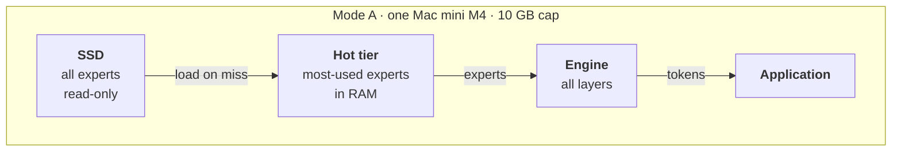
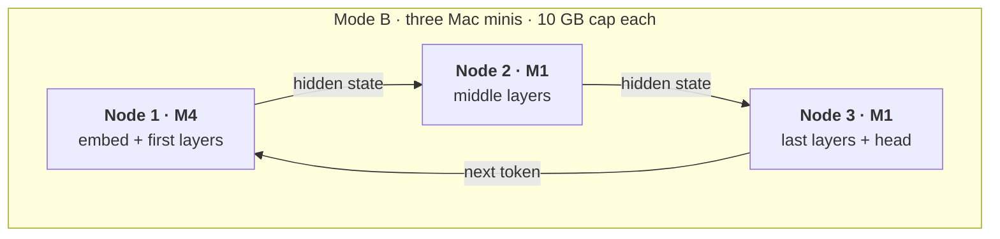
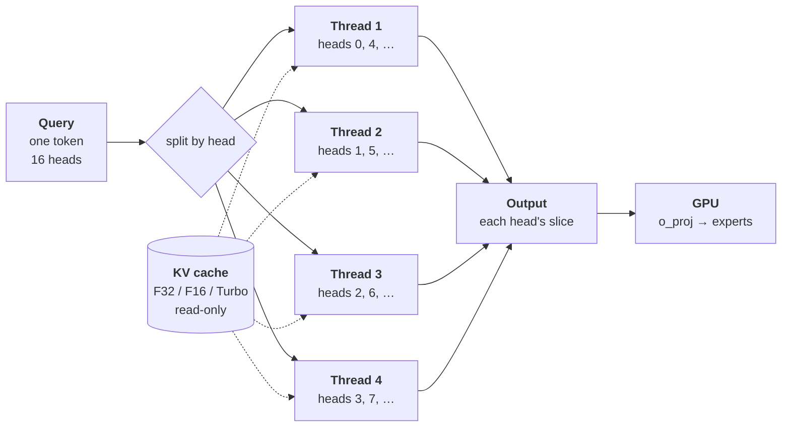

# moeflux

Pure-Rust streaming-experts Mixture-of-Experts inference for Apple
Silicon — **revamped** to run large MoE models inside a hard,
user-set memory cap, on one Mac or across a small cluster of Macs.

> **This fork is a whole-system revamp.** It keeps moeflux's engine
> and Metal kernels, and rebuilds everything around them: memory is
> governed by a strict budget, experts stream from SSD through a
> fixed-size hot tier with no OS page cache, a model can be split by
> layer range across nodes, and several requests can share the
> pipeline. The full design and phase plan is in
> [`docs/fork-upgrade-plan.md`](docs/fork-upgrade-plan.md); the
> motivation is in
> [`docs/moeflux fork proposed changes.md`](docs/moeflux%20fork%20proposed%20changes.md).
> The revamp is in progress — see [Status](#status) for what exists
> today and what is planned.

## Goals

- **Hard memory cap.** The engine never pushes total memory use past
  the cap you set (e.g. 10 GB), including page cache it would cause,
  so other services on the same machine are untouched. Everything is
  reserved at open; if it does not fit, `open` fails before anything
  else is affected.
- **Streaming experts, designed for a hard cap.** Experts stream from
  SSD with `F_NOCACHE` reads into a fixed hot tier and slot ring, with
  profile-seeded, frequency-based caching and speculative prefetch.
- **Compact KV cache.** The attention cache can be stored as F16 or
  TurboQuant 4/3-bit instead of f32; under a cap the memory it frees
  goes to the expert hot tier.
- **Router hook.** After routing, the engine hands each layer's
  picked experts and gate weights to a policy, which decides per
  expert whether to run it at 4-bit, run it at 2-bit, or skip it.
  The policy can live outside moeflux; the engine exposes the hook.
- **Two modes, one code path.**
  - *Mode A — single node:* Mac mini M4 24 GB, experts on an external
    SSD, 10 GB cap.
  - *Mode B — three-node pipeline:* M4 + 2 × M1 16 GB, each node runs
    a contiguous layer range with its experts resident in RAM.
- **Throughput:** several requests in flight across the pipeline.
- **Telemetry:** per token, per layer, per tier.

## Architecture

The same engine runs in both modes, always inside a hard memory cap.

### Mode A — single node, streaming

One Mac runs every layer. Experts live on the SSD; the most-used ones
sit in a fixed-size hot tier in RAM, and the rest stream in on demand.



### Mode B — three-node pipeline

Each Mac runs a slice of the layers and holds all of that slice's
experts in RAM, so nothing streams from disk. Hidden states flow from
node to node; the next token returns to the first node.



### Decode attention across cores

When the GPU attention fast path is not used — streaming or capped
runs, or a quantized `kv_format` — each decode step's attention runs
on the CPU. Its query heads are independent, so they are split across
a small thread pool (`attn_threads`, default 4). Every thread reads
the same KV cache (read-only, shared with the GPU) and writes only its
own heads' slice of the output, so no locks are needed and the result
is bit-identical to one thread.



Per head, a thread scores the query against every cached key,
takes the softmax, and sums the weighted values. Turbo formats work
on the stored 4/3-bit codes directly, without decompressing the cache.
The pool picks up heads dynamically (work stealing), so the head
assignment above is illustrative. On OLMoE at 2.7k context this made
decode 55–58% faster; short contexts gain little, since attention is
then a small part of each step.

Details — memory accounts, the per-token data path, phases — are in
[`docs/fork-upgrade-plan.md`](docs/fork-upgrade-plan.md).

### Repository layout

- `crates/moeflux/` — the engine. `RsCtx` (re-exported as `Ctx`) is
  the public surface. `src/riir/` holds `backend/{cpu,gpu}`, `attn/`,
  `moe/`, `io/` (expert streaming, prefetch), `snapshot/`
  (state save/load) and `variants.rs` (compile-time model shapes).
  Kernels in `shaders/shaders.metal` are embedded via `include_str!`
  and compiled at runtime.
- `crates/moeflux-metal/` — MLX-derived quantized GEMM and gather
  kernels.
- `crates/moeflux-net/` — mode B pipeline: frames, the
  `moeflux-node` and `moeflux-coord` binaries, and the range planner.
- `scripts/` — model-prep pipeline (`extract_weights.py`,
  `export_vocab.py`, `export_tokenizer.py`), the test-host check
  (`check_test_host.sh`, run before any test phase), profiling
  (`profile_smoke.sh`, `profile_aggregate.py`) and `watch_run.sh`
  (samples a run's memory and CPU).
- `tools/` — model converters (`convert_olmoe.py`,
  `convert_cogito_v2.py`), a NumPy reference forward for OLMoE
  (`olmoe_ref.py`), an expert-cache simulator that replays routing
  traces (`sim_expert_cache.py`), `gen_expert_index.py`,
  `export_vision.py` (the Qwen3.5 / 3.6 vision tower for
  `riir::vision`), `chat/` (a local chat page for Qwen3.6-35B-A3B under
  a cap, with images and a live CPU / RAM bar), and
  `mlx_reference/` — the MLX reference diff harness
  (`crates/moeflux/tests/mlx_regression.rs` regenerates its goldens).
- `docs/` — design notes and the upgrade plan.

## Status

**Alpha** — `0.2.0-alpha.1`, the first release of the revamp, based on moeflux `0.1.0-pre.4`. APIs may still change; changes are listed in [`CHANGELOG.md`](CHANGELOG.md).

| Area | State |
| --- | --- |
| Engine, Metal kernels, Qwen3.5-A17B / Qwen3.6-35B-A3B / Cogito-V2 variants | Exists |
| OLMoE-1B-7B variant (small test model: converter, NumPy reference, model tests under a cap) | Implemented — the model-level test bed on hosts without a3b weights |
| Expert streaming: mmap mode, pread + speculative prefetch, slot ring | Exists |
| Differential oracles (CPU vs Metal, batched vs per-token, MLX) | Exists |
| `OpenConfig`, `n_ctx`-sized KV, memory cap (plan, reserve at open, footprint checks) | Implemented — Phase 1; model-level tests pending |
| `F_NOCACHE` reads, fixed hot tier, routing profiles, expert-IO counters | Implemented — Phase 2; model-level tests pending |
| Layer-range execution (`layer_range`, `eval_stage`, f32 hidden in/out, per-range snapshots) | Implemented — Phase 3; model-level tests pending |
| Per-request state (`max_requests` pool, `admit_request` / `drop_request` / `eval_request`) | Implemented — Phase 4; model-level tests pending |
| `moeflux-net`: frames, `moeflux-node`, `moeflux-coord`, planner (TCP loopback) | Implemented — Phase 5; model-level tests pending |
| Streaming improvements: telemetry (`ExpertIoStats`, CSV), bounded I/O (`io_queue_depth`, `io_bytes_per_sec`), in-place coalesced prefill reads, cross-layer guesses, lookahead prefetch, `fast_experts_dir` disk tier, `prefetch_experts` (prefetch width) | Implemented — Phase 6; knobs default off except `prefetch_experts` = 4 under a cap (measured on OLMoE-1B-7B, +4–15% tok/s); a3b/a17b model tests pending |
| KV cache formats (`kv_format`: F32, F16, TurboQuant 4/3-bit; snapshot v4) | Implemented — F32 default; on OLMoE-1B-7B at a 3 GiB cap and n_ctx 4096, F16 / Turbo4 shrink KV 1.00 → 0.56 / 0.19 GiB (incl. prefill scratch) and decode +29% / +44% faster (the freed memory goes to the hot tier); answers correct in every format. MLA (Cogito) stays F32 |
| Decode attention threads (`attn_threads`, default 4) | Implemented — bit-identical output; on OLMoE at 2.7k context decode +55–58% tok/s (F32 and Turbo4) |
| Router policy, 2-bit | Planned — Phases 7–8 |

Build with exactly one model feature (`model-qwen3-6-35b-a3b`,
`model-qwen3-5-a17b`, `model-cogito-v2-671b`, `model-olmoe-1b-7b`):

```bash
cargo build --features model-qwen3-6-35b-a3b
# the whole workspace, moeflux-net included
cargo build --workspace --features model-qwen3-6-35b-a3b
```

Opening under a cap, with a compact KV cache:

```rust
use moeflux::{Ctx, KvFormat, OpenConfig};

let cfg = OpenConfig {
    n_ctx: 4096,
    mem_cap: Some(10 << 30),        // hard cap, bytes
    kv_format: KvFormat::Turbo4,    // F32 (default) | F16 | Turbo4 | Turbo3
    ..OpenConfig::default()         // hot tier takes what the plan leaves
};
let mut ctx = Ctx::open_with(&weights, &manifest, &vocab, &experts_root, false, &cfg)?;
```

`open_with` fails with `Error::OverBudget` if the plan does not fit the cap.

Tests: run `scripts/check_test_host.sh` first; it says which tier
(unit/kernel or model) this host can run. Fixed bugs, open issues and
traps are listed in [`docs/known-issues.md`](docs/known-issues.md).

## Running Qwen3.6-35B-A3B on a small Mac

Measured on an M3 Pro (11 cores, 18 GB RAM, internal SSD) shared with
other services, with 5–7 GiB of RAM reclaimable. The model is 19.4 GB
at 4-bit; under a cap it streams experts from the SSD and keeps only
the hot ones in RAM, so it runs in 3–5 GiB.

### What it costs

| Resource | Cost |
| --- | --- |
| Disk | 20.4 GB download (`mlx-community/Qwen3.6-35B-A3B-4bit`) + 18.3 GB converted (1.3 GB non-expert weights, 16.9 GB packed experts) ≈ 39 GB. The MLX download can be deleted after conversion if you don't need `engine_op_diff` |
| RAM | Whatever you cap it at: a 3 GiB cap peaks at 2.65 GiB, 4 GiB at 3.65 GiB, 5 GiB at 4.65 GiB. Below ~3 GiB the fixed parts don't fit and `open_with` fails with `OverBudget` |
| Page cache | None from expert reads: under a cap they use `F_NOCACHE`, so the file cache other processes rely on is not evicted |
| CPU | 4 threads for decode attention (`attn_threads`), plus the I/O threads; the GPU does the rest |
| SSD | 380–600 MiB read per token (fewer with a bigger hot tier) |

Fixed parts of a 4 GiB plan (n_ctx 4096): weights 1.29 GiB, prefill
staging 0.42, runtime overhead 0.50, prefill scratch 0.23, linear-attention
state 0.12, expert slots 0.09, KV 0.02–0.15 (Turbo4 / F32). The hot tier
gets the rest: 1.2–1.3 GiB. Measured footprint stays 0.08 GiB within
the plan.

### Speed

Greedy decode, n_ctx 4096, 64 tokens, one batch of runs:

| Cap | Hot tier | Hot-tier hits | Decode, short prompt | Decode at 3.3k context | Prefill |
| --- | --- | --- | --- | --- | --- |
| 3 GiB | 0.30 GiB | 11% | 216 ms/tok (4.6 tok/s) | 246 ms/tok | 137 tok/s |
| 4 GiB | 1.31 GiB | 33% | 200 ms/tok (5.0 tok/s) | 225 ms/tok | 135 tok/s |
| 5 GiB | 2.31 GiB | 48% | 186 ms/tok (5.4 tok/s) | 224 ms/tok | 140 tok/s |

`attn_threads: 1` instead of 4 makes long-context decode 321 instead of
225 ms/tok. At 465 MiB/tok in 200 ms decode reads ~2.3 GB/s, below what
the SSD sustains (~6.7 GB/s), so more speed has to come from the engine
side, not the disk. Answers are identical across caps, and match MLX:
argmax equal, top-20 overlap 20/20 with F32 KV and 19/20 with Turbo4
(the gate in `mlx_regression.rs` is 19). On a3b the KV cache is small
(10 full-attention layers, 2 KV heads), so F32 KV costs little and
Turbo4 gains nothing measurable.

The table uses the default prefetch (previous token's experts, 4 per
layer). On a3b, `prefetch_guess: PrefetchGuess::CrossLayer` — guess the
next layer's experts from the current hidden state, so their reads start
while the GPU is still busy — is faster with identical output (3 GiB cap,
repeated runs):

| Prefetch | Decode, short prompt | Decode at 3.3k context | I/O wait | Prefetch hits |
| --- | --- | --- | --- | --- |
| previous token, 4 (default) | 214–227 ms/tok (4.5 tok/s) | 267–295 ms/tok | 92–103 ms/tok | 63 / tok |
| cross-layer, 4 | 187–189 ms/tok (5.3 tok/s) | 229–243 ms/tok | 70 ms/tok | 127 / tok |
| cross-layer, 6 | **179 ms/tok (5.6 tok/s)** | 229 ms/tok | 68 ms/tok | 180 / tok |
| cross-layer, 8 | 192 ms/tok | 245 ms/tok | 75 ms/tok | 218 / tok |

More CPU threads do not help: `io_threads` 16 and `attn_threads` 8 match
the defaults. The rest of a token (~105 ms) is the CPU waiting on the
GPU's per-layer post-attention command buffer. On OLMoE-1B-7B the
cross-layer guess did not help.

### Setup

```bash
scripts/check_test_host.sh               # CPU, RAM, headroom, disk

M=~/models/qwen3-6-35b-a3b
hf download mlx-community/Qwen3.6-35B-A3B-4bit --local-dir $M/mlx-4bit

python3 -I scripts/extract_weights.py --model $M/mlx-4bit --output $M/artifacts
python3 -I scripts/export_vocab.py $M/mlx-4bit/tokenizer.json $M/artifacts/vocab.bin
python3 -I tools/gen_expert_index.py --mlx-path $M/mlx-4bit --out $M/expert_index.json
python3 -I repack_experts.py --index $M/expert_index.json --output-dir $M/root/packed_experts
python3 -I tools/export_vision.py --model $M/mlx-4bit --out $M/artifacts   # optional: images
```

Conversion needs Python with NumPy, peaks under 0.3 GiB of RAM and
takes about 20 s once downloaded.

Then open it under a cap — `OpenConfig { mem_cap: Some(4 << 30),
n_ctx: 4096, max_checkpoints: 0, .. }` — or point the tests at it:

```bash
export MOEFLUX_SMOKE_ARTIFACTS=$M/artifacts MOEFLUX_SMOKE_ROOT=$M/root MOEFLUX_SMOKE_MLX=$M/mlx-4bit
```

`tests/mrope.rs` (multimodal positions) runs the model under a 3 GiB
cap. `tests/vision.rs` checks the vision encoder against reference
embeddings from transformers: set `MOEFLUX_VISION_DIR=$M/artifacts` and
`MOEFLUX_VISION_REF` to a folder of `<name>.rgb` (resized RGB bytes),
`<name>.emb` (f32 rows) and `meta.json` (`{name: {h, w}}`).

The a3b oracle suites (`--include-ignored`) open the model *without* a
cap and need ≥ 8 GiB reclaimable; `check_test_host.sh` says whether this
host qualifies. On a smaller host, run the model only under a cap.

### Chat page

`tools/chat` is a local chat page for trying the model yourself
(standalone crate; the engine gains no dependencies):

```bash
cd tools/chat
cargo run --release -- --cap-gib 4 --n-ctx 8192
# options: --kv f32|f16|turbo4, --attn-threads N, --guess cross|prev, --prefetch N
# open http://127.0.0.1:8077
```

It listens on 127.0.0.1 only and keeps one conversation in the KV
cache, so each message prefills only the new text. The header shows
memory against the cap and the context used; each answer shows tok/s,
prefill speed, hot-tier hits and disk MiB per token. Thinking can be
toggled. It defaults to the cross-layer guess with 6 experts prefetched
(≈ 7 tok/s on a 115-token answer at a 4 GiB cap). Stop the server
(Ctrl-C) to give the memory back.

A bar under the header shows the process's CPU (as cores used), its
memory against the cap with the peak, and the host's reclaimable
memory, sampled every second; it keeps updating while an answer is
generated. Each answer also reports its average CPU.

**Images.** With `artifacts/vision_weights.bin` exported, an *Image…*
button appears (paste works too). The page resizes the picture so both
sides are multiples of 32 and the area is at most `--vision-max-pixels`
(default 640 × 640 = 400 image tokens); the CPU vision encoder
(`moeflux::riir::vision`, Accelerate GEMMs, `--vision-threads` default
4) turns it into embeddings, and the model reads them at their M-RoPE
positions (`Ctx::eval_stage_mrope`). The encoder streams its 0.85 GiB
of BF16 weights from disk for each image and keeps 137 MiB of buffers,
counted in the cap (`OpenConfig::host_buffers`). `--no-vision` turns it
off. Measured at a 4 GiB cap on the M3 Pro:

| Image | Image tokens | Encode | Prefill (whole turn) | Process memory | CPU (peak, whole run) |
| --- | ---: | ---: | ---: | ---: | ---: |
| 448 × 320 | 140 | 1.1 s | 5.3 s | 3.69 GiB | ≤ 2.1 cores |
| 512 × 512 | 256 | 1.9 s | 5.7 s | 3.69 GiB | ≤ 2.1 cores |
| 640 × 640 (cap) | 400 | 3.2 s | 5.3 s | 3.71 GiB | ≤ 2.1 cores |

Decode after an image runs at the usual speed. Scenes, colors, layout
and counting work (a 2 × 2 color grid, five dots, shapes and their
positions, a photo); reading small or short printed text is
unreliable. MLX makes the same mistakes when given the same image
embeddings (see `docs/known-issues.md`), so this comes from the model,
not the engine. Larger images help: "7780" read correctly at 640 × 320
and not at 512 × 256.

### Qwen3-30B-A3B

Qwen3-30B-A3B (the `qwen3_moe` architecture: 48 full-attention layers,
128 experts, top-8, no linear attention) is **not supported yet**: it
needs its own variant, likely closer to the OLMoE path than to the
Qwen3.6 one. Estimated from its shape, not measured: ~16 GB of 4-bit
experts at ~2.65 MB each, ~1 GB read per token with a cold hot tier —
about twice Qwen3.6-35B-A3B — and 192 KiB of F32 KV per token
(0.75 GiB at n_ctx 4096, ~0.1 GiB with Turbo4), so it would decode
slower than Qwen3.6-35B-A3B at the same cap and gain more from a
quantized `kv_format`.

## Provenance

moeflux began as a fork of
[danveloper/flash-moe](https://github.com/danveloper/flash-moe) and
was rewritten in Rust by [mdegans/moeflux](https://github.com/mdegans/moeflux)
to the point of being a distinct codebase. The host-side engine is
Rust on `metal-rs`; the original C/Objective-C functions served as
differential oracles during that rewrite. The Metal
streaming-experts kernels were authored by **Claude Opus 4.6**
(Anthropic) for flash-moe and carry over here. This fork builds the
revamp described above on top of that work. The math is the same
linear algebra every inference engine runs — nothing here is
claimed as novel.

## License

MIT — see [`LICENSE`](LICENSE). See also [`CONTRIBUTORS.md`](CONTRIBUTORS.md).

## Acknowledgements

- **@danveloper** — for building the thing the hard way, writing it
  up, and publishing everything openly. moeflux started as flash-moe
  and git history reflects that.
- **@mdegans** — for the Rust rewrite this fork builds on.
- **Claude Opus 4.6** — for the Metal streaming-experts kernels and
  the architecture that made all of this run.
- **Anthropic** — for making Claude available to do work like this in
  the first place.
