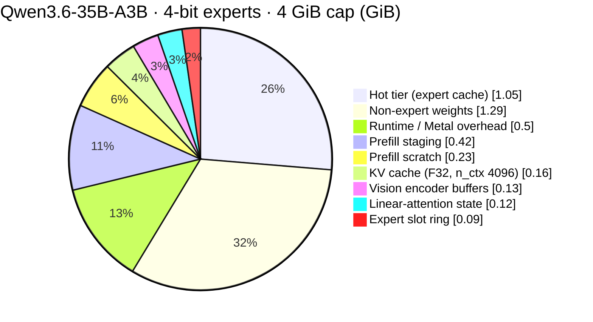
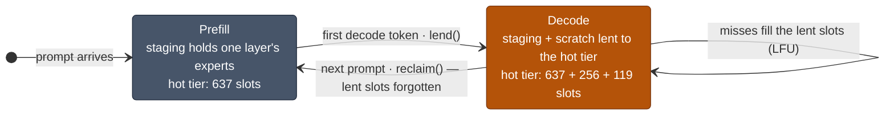
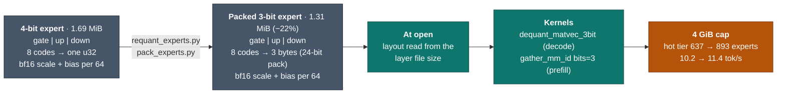
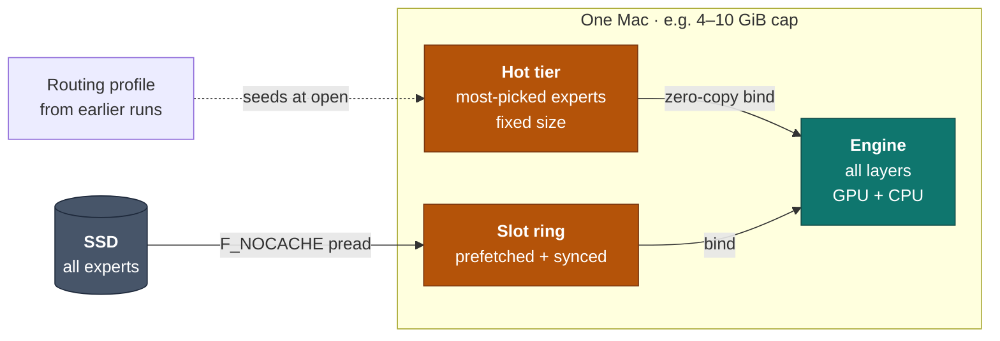
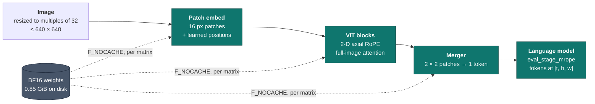
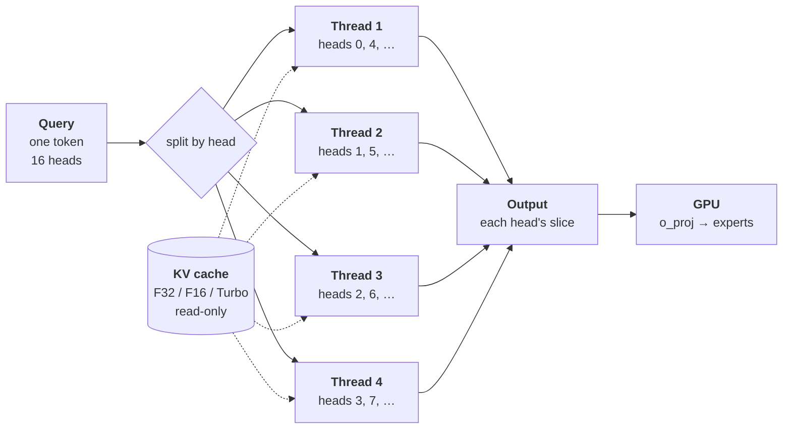

# Architecture — AEGIS

How streamoe runs a model several times larger than its memory cap. The short version is in the [README](../README.md#architecture--aegis); measurements are in [`benchmarks.md`](benchmarks.md).

The engine's design is called **AEGIS**: **A**daptive · **E**xpert ·
**G**uarded · **I**n-memory · **S**treaming. An aegis is a shield. The
memory cap is its rim: nothing inside crosses it, nothing outside it is
disturbed, and everything inside works to run a model several times
larger than the shield — fast.

| | Principle | What does it |
| --- | --- | --- |
| **A** · Adaptive | Fit the work to the cap and to what the model is doing right now | cross-layer expert guesses, per-slot prefetch waits, LFU hot-tier admission that forgets old topics in ~13 tokens, lending idle buffers, 4-bit or packed 3-bit experts |
| **E** · Expert | Make every routed expert cheap to read and to run | packed 3-bit layout (−22% bytes, detected at open), fused gather kernels (`gather_mm_id`), `qmv` for single-token matvecs |
| **G** · Guarded | Memory is a contract, not an estimate | the budget plan at open (`OverBudget` before anything is touched), `F_NOCACHE` so neighbours keep their page cache, vision and KV inside the plan |
| **I** · In-memory | Bytes already in RAM do as much work as they can | the hot tier (zero-copy bind), the slot ring, compact KV (F16, Turbo4/3), prefill staging and scratch lent to decode |
| **S** · Streaming | Disk is a tier, and its time is measured | parallel `F_NOCACHE` pread overlapped with GPU work, `STREAMMOE_IO_TRACE` and `STREAMMOE_GPU_TIMING` timelines |

## Data flow

  

One decode step, by the numbers on the diagram:

1. The application sends a prompt token to `Ctx` (an image goes to the
   vision encoder first, which hands its embeddings to attention).
2. Attention reads the non-expert weights and updates the KV cache or
   the linear-attention state.
3. The router picks 8 of 256 experts on the model's own logits.
4. The adaptive layer guesses the next layer's experts from the
   residual and prefetches them into the slot ring.
5. Missed and prefetched experts stream in from the SSD with
   `F_NOCACHE` reads — with the vision weights (once per image), the
   only bytes that cross the red rim, the memory cap.
6. The hot tier and the slot ring bind experts to the kernels in
   place; hotter misses are admitted to the hot tier.
7. The expert kernels run (hot experts first) and the step loops over
   all 40 layers.
8. The LM head turns the last hidden state into logits and the next
   token goes back to the caller.

## G · Guarded: memory planned, not hoped for

At open, streamoe sizes every account for the context you asked for —
`n_ctx`, KV format, request slots, checkpoints, host buffers — and the
expert hot tier takes exactly what is left. Expert reads use
`F_NOCACHE`, so the engine never grows the page cache and nothing else
on the machine loses its file cache. The plan `tools/chat` prints at
open for the [standard setup](benchmarks.md#test-setup) with 4-bit experts and a
4 GiB cap:

With packed 3-bit experts the prefill staging shrinks to 0.33 GiB and
the hot tier grows to 1.14 GiB. In the [speed runs](benchmarks.md#speed) the peak
stayed 0.35–0.39 GiB under every cap (2.6 / 3.6 / 4.6 / 5.6 GiB at
3 / 4 / 5 / 6 GiB). Long runs hold too: a 130-token prompt plus a
128-token answer under a 4 GiB cap grows by 1 MiB between the 16th and
the 128th token, at the default 0.5 GiB runtime allowance (it grew
without bound before a missing autorelease pool was added, 2026-10-28;
`budget_cap::a3b_long_decode_stays_under_4gib_cap` now guards it). A Turbo4 KV cache
shrinks the KV slice to 0.02 GiB and the hot tier grows by the
difference; on models with large KV caches (OLMoE-1B-7B at n_ctx 4096)
that trade alone made decode 44% faster.

## I · In-memory: idle prefill memory serves decode

The prefill staging buffer (0.42 GiB, one slot per expert) and the
batched-prefill scratch (0.23 GiB) are only written while a prompt is
read. During decode they would sit idle, so the hot tier borrows them:
375 more expert slots (4-bit) without a byte over the plan. The next
prompt takes them back before its first chunk, zeroing what the tier
wrote into the scratch.

The tier also forgets fast: popularity counters halve every 4096 picks
(~13 tokens), so when the topic changes the last topic's experts give
up their slots within a sentence instead of holding them for ~200
tokens.

In the [standard setup](benchmarks.md#test-setup) (4-bit experts, 4 GiB cap), lending
lifts hot-tier hits from 57 / 47 / 60% to 67 / 56 / 70% on the three
test prompts and decode from 8.8 to 10.2 tok/s (+16%); fast forgetting
alone is worth 8.5 → 10.2 tok/s (+20%,
[Prefetch and reuse](benchmarks.md#prefetch-and-reuse)). `STREAMMOE_HOT_LEND=0` turns
lending off; `STREAMMOE_HOT_DECAY=<picks>` sets the forgetting period.

## E · Expert: packed 3-bit

Decode is bound by bytes from the SSD, so the cheapest expert is the
smallest one that still gives the same answers. Packed 3-bit stores
8 codes in 3 bytes instead of 4; the kernels keep the 4-bit element
order and `w = scale · q + bias`, so packed and nibble-stored 3-bit
give bit-identical output.

Against 4-bit: KL 0.048, the same top token 93% of the time, all 10
scored tasks right (`tools/chat` `quality` bin). 2-bit broke tool
calls, maths, JSON and code, so it is not offered.

## A + S · One layer of decode

Each layer hides as much of its I/O as it can behind GPU work:

```mermaid
sequenceDiagram
    autonumber
    participant C as CPU
    participant IO as I/O pool
    participant G as GPU
    participant H as Hot tier
    participant S as SSD

    Note over C: layer L begins (layer L−1's GPU work drained)
    C->>C: A · guess L's experts — cross-layer from L−1's residual,<br/>or the previous token's picks
    C->>H: drop guesses that are already hot
    C-)IO: S · prefetch the rest into slot set L mod 2
    par overlapped
        G->>G: attention + router logits
        Note right of G: full-attention layers under a cap run<br/>on CPU threads (attn_threads)
    and
        IO->>S: parallel F_NOCACHE pread
        S-->>IO: expert bytes → prefetch slots
    end
    G->>C: router logits
    C->>C: top-k on the model's own logits
    C->>H: I · hot hits bind their RAM slot (zero copy, zero I/O)
    C->>S: misses: parallel pread → synced slots
    C->>IO: A · wait only for the prefetched slots L picked
    Note over C,IO: an unused guess still in flight is not waited for
    C->>G: E · K-expert matvec + combine, chained into L+1's norm
    C->>H: A · count picks, admit misses hotter than a sampled victim (LFU)
```

On Qwen3.6-35B-A3B (40 layers, 256 experts, 8 picked per token) the
cross-layer guess with 6 experts prefetched uses 50–71 prefetched
experts per token instead of 5–8 with the previous-token guess, and
decodes 12% faster (9.1 → 10.2 tok/s, 4-bit, 4 GiB) — with identical
output; see [Prefetch and reuse](benchmarks.md#prefetch-and-reuse). Guesses only decide *what to
read early*; routing always uses the model's own logits.

A decode token at a 4 GiB cap (4-bit experts, ~99 ms) spends ~37% of
its time waiting on the SSD; the rest is GPU kernels, CPU work and GPU
wake-up gaps (split in the
[breakdown](benchmarks.md#where-a-decode-token-goes), measured on
an earlier build); the CPU uses ~0.6 of 11 cores. So the levers are
fewer bytes from disk and fewer, longer GPU bursts — not more threads.

## S · Streaming: measured, not assumed

`STREAMMOE_IO_TRACE=<file>` records every expert read and the phase of
each layer; `tools/io_trace_report.py` turns it into disk busy / idle
time ([sample report](benchmarks.md#disk-timeline)).
Prefill staging runs at the SSD's limit (~4.1–4.6 GB/s here), and the
disk's idle time in decode comes in ~1 ms pieces too short to fill with
more prefetch — the tries are in
[`docs/known-issues.md`](known-issues.md). What lowers decode time
now is fewer bytes per token (packed 3-bit, a bigger cap) and less GPU
time.

## Mode A — one Mac, streaming

One machine runs every layer. A small hot tier serves the most-used
experts from RAM; the rest stream from disk on demand.

## Mode B — multiple Macs (separate repository)

**This repository handles mode A only.** Running one model across
several Macs — nodes, a coordinator, a layer-range planner, network
frames — is handled by a separate repository that builds on this
engine.

What stays here is the per-range engine API a pipeline needs:
`OpenConfig::layer_range` (open, plan and run only layers `a..b` inside
the cap), `Ctx::eval_stage` with f32 hidden states in and out, and
per-range snapshots. `crates/streammoe-net/` is the earlier prototype of
the pipeline (TCP loopback tested); it stays as a reference and is not
developed further here.

## Vision inside the shield

Qwen3.5 / 3.6 take images through a CPU vision encoder that lives inside
the same cap: its weights stream from disk per image, its 137 MiB of
buffers are part of the plan.

The encoder matches transformers exactly and mlx_vlm to 0.997; a
640 × 640 image becomes 400 tokens in ~3 s.

## Decode attention across cores

When the GPU attention fast path is not used — streaming or capped
runs, or a quantized `kv_format` — each decode step's attention runs
on the CPU. Its query heads are independent, so they are split across
a small thread pool (`attn_threads`, default 4). Every thread reads
the same KV cache (read-only, shared with the GPU) and writes only its
own heads' slice of the output, so no locks are needed and the result
is bit-identical to one thread.

Per head, a thread scores the query against every cached key,
takes the softmax, and sums the weighted values. Turbo formats work
on the stored 4/3-bit codes directly, without decompressing the cache.
The pool picks up heads dynamically (work stealing), so the head
assignment above is illustrative. *Setup: OLMoE-1B-7B, 2.7k-token
context, F32 and Turbo4 KV:* this made decode 55–58% faster; short contexts gain little, since attention is
then a small part of each step.

## Repository layout

The project is called streamoe; its crates, binaries and environment
variables are spelled `streammoe` / `STREAMMOE_*`.

- `crates/streammoe/` — the engine. `RsCtx` (re-exported as `Ctx`) is
  the public surface. `src/riir/` holds `backend/{cpu,gpu}`, `attn/`,
  `moe/`, `io/` (expert streaming, prefetch), `snapshot/`
  (state save/load) and `variants.rs` (compile-time model shapes).
  Kernels in `shaders/shaders.metal` are embedded via `include_str!`
  and compiled at runtime.
- `crates/streammoe-metal/` — MLX-derived quantized GEMM and gather
  kernels.
- `crates/streammoe-net/` — earlier mode B prototype (frames,
  `streammoe-node`, `streammoe-coord`, range planner); kept as a reference,
  not developed further here — mode B lives in a separate repository.
- `scripts/` — model-prep pipeline (`extract_weights.py`,
  `export_vocab.py`, `export_tokenizer.py`, `repack_experts.py`), the test-host check
  (`check_test_host.sh`, run before any test phase), profiling
  (`profile_smoke.sh`, `profile_aggregate.py`) and `watch_run.sh`
  (samples a run's memory and CPU).
- `tools/` — model converters (`convert_olmoe.py`,
  `convert_cogito_v2.py`), a NumPy reference forward for OLMoE
  (`olmoe_ref.py`), an expert-cache simulator that replays routing
  traces (`sim_expert_cache.py`), `gen_expert_index.py`,
  `export_vision.py` (the Qwen3.5 / 3.6 vision tower for
  `riir::vision`), `requant_experts.py` / `pack_experts.py` (packed
  3-bit experts), `io_trace_report.py`, `chat/` (a local chat page for
  Qwen3.6-35B-A3B under a cap, with images and a live CPU / RAM bar,
  plus the `quality`, `verify_bench`, `spec_bench` and `batch_bench`
  bins), and
  `mlx_reference/` — the MLX reference diff harness
  (`crates/streammoe/tests/mlx_regression.rs` regenerates its goldens).
- `docs/` — architecture, benchmarks, status and tests, known issues, the chat page and model variants.
