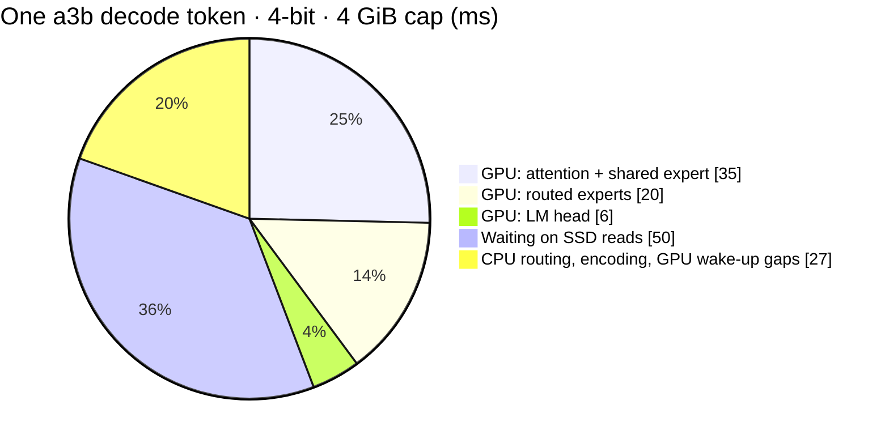

# Benchmarks

Detailed measurements behind the numbers in the [README](../README.md):
Qwen3.6-35B-A3B on a shared 18 GB M3 Pro, under memory caps of 3–6 GiB.
Ideas that were measured and did not pay off are in
[`known-issues.md`](known-issues.md).

## Test setup

Every number here and in the README comes from this setup unless its
*Setup* line says otherwise.

| | Standard setup |
| --- | --- |
| Host | MacBook Pro, M3 Pro (11-core CPU), 18 GB RAM, internal SSD; shared with other services, 7–8 GiB reclaimable during the runs |
| Model | Qwen3.6-35B-A3B from `mlx-community/Qwen3.6-35B-A3B-4bit`, converted as in [Setup](../README.md#setup); experts 4-bit (`root/`) or packed 3-bit (`root-3bit/`) |
| Engine | `tools/chat` release build, 2026-10-26; a fresh server per run, the KV cache reset between prompts |
| Settings | n_ctx 4096, F32 KV, cross-layer guess with 6 experts prefetched, `attn_threads` 4, vision on (its 0.13 GiB is in the plan), thinking off, greedy (temperature 0) |
| Prompts | *Photosynthesis* — "Explain photosynthesis to a ten-year-old in one paragraph." (120 tokens decoded) · *JavaScript* — "Write a JavaScript function that checks whether a string is a palindrome." (74) · *Hiking* — "Give me a short packing list for a weekend hiking trip." (120) |
| Reported | tok/s = decoded tokens ÷ decode time (the chat page's figure); hot-tier hits and disk MiB per decode token; first word = request to first streamed token; peak = process footprint. Each value is the mean of 2 runs (the runs agree within ±6%) |
| Units | GiB / MiB for memory and disk (1 GiB = 2³⁰ bytes); GB/s only for SSD bandwidth; the Mac's RAM as sold (18 GB) |

## Speed

*Setup: standard; caps 3–6 GiB.* tok/s per prompt (Photosynthesis /
JavaScript / Hiking) and over all three:

| Cap | Experts | Hot tier | tok/s per prompt | tok/s, all | Hot-tier hits | Disk MiB / token | First word | Peak |
| --- | --- | --- | --- | --- | --- | --- | --- | --- |
| 3 GiB | 4-bit | 0.05 GiB | 6.9 / 5.8 / 6.5 | **6.5** | 38 / 22 / 35% | 372 / 477 / 392 | 1.6–1.8 s | 2.73 GiB |
| 3 GiB | packed 3-bit | 0.14 GiB | 7.7 / 6.9 / 7.6 | **7.5** | 42 / 23 / 35% | 278 / 368 / 310 | 1.3–1.5 s | 2.69 GiB |
| 4 GiB | 4-bit | 1.05 GiB | 8.0 / 6.4 / 7.6 | **7.4** | 59 / 34 / 54% | 258 / 413 / 289 | 1.6–1.8 s | 3.74 GiB |
| 4 GiB | packed 3-bit | 1.14 GiB | 8.8 / 7.2 / 8.2 | **8.1** | 64 / 38 / 54% | 180 / 305 / 225 | 1.3–1.5 s | 3.73 GiB |
| 5 GiB | 4-bit | 2.05 GiB | 8.7 / 6.9 / 8.0 | **7.9** | 70 / 45 / 64% | 190 / 350 / 230 | 1.4–2.0 s | 4.74 GiB |
| 5 GiB | packed 3-bit | 2.14 GiB | 9.2 / 7.7 / 8.7 | **8.6** | 76 / 51 / 66% | 124 / 248 / 174 | 1.2–1.7 s | 4.73 GiB |
| 6 GiB | 4-bit | 3.05 GiB | 9.0 / 7.0 / 8.6 | **8.3** | 78 / 54 / 72% | 141 / 296 / 187 | 1.3–2.5 s | 5.74 GiB |
| 6 GiB | packed 3-bit | 3.14 GiB | 9.9 / 8.3 / 9.1 | **9.2** | 84 / 62 / 74% | 87 / 198 / 135 | 1.1–1.6 s | 5.72 GiB |

How to read it:

- **Packed 3-bit is 9–15% faster at every cap**, and packed 3-bit at
  4 GiB is about as fast as 4-bit at 5 GiB. Quality against 4-bit: KL
  0.048, the same top token 93% of the time, perplexity 1.15 → 1.21,
  all 10 scored tasks right (JSON, tool calls, arithmetic, code).
- **Each extra GiB adds 5–14%**, most going from 3 to 4 GiB with 4-bit
  experts. The JavaScript prompt spreads over
  the most experts, so it reads the most from disk at every cap.
- **The hot tier at 3 GiB is nearly empty**, yet hits are 22–42%: the
  256 prefill-staging slots lent to the hot tier during decode carry it.
- **The part of a token that is not disk wait is ~87 ms at every cap**
  (forward time minus disk wait: 84–92 ms in every cell of the table). That is the
  ceiling: with every expert in RAM — a ~16 GiB cap for packed 3-bit
  (13.1 GiB of experts), ~20 GiB for 4-bit — decode would reach about
  **11.5 tok/s** (*estimated, not measured*: this 18 GB host can't spare
  that much). A cap above what other programs leave free makes the
  machine swap and is slower than a small cap.
- First word is time to the first streamed token for a ~25-token
  prompt; the chat template plus a short question prefills at 14–22
  tok/s because each token picks new experts. Long prompts prefill far
  faster (135+ tok/s for a 3.3k-token prompt, measured on an earlier
  build).
- **Answers match MLX.** Output is identical across caps; with 4-bit
  experts, argmax equals the MLX reference and the top-20 overlap is
  20/20 with F32 KV and 19/20 with Turbo4 (the gate in
  `mlx_regression.rs` is 19). On a3b the KV cache is small (10
  full-attention layers, 2 KV heads), so F32 KV costs little and Turbo4
  gains nothing measurable.

## Prefetch and reuse

*Setup: standard, 4-bit experts, 4 GiB cap; one setting changed per
row.*

| Setting | tok/s per prompt | tok/s, all | Hot-tier hits | Disk wait, ms / token | Prefetched experts used / token |
| --- | --- | --- | --- | --- | --- |
| **standard** (cross-layer guess, 6 prefetched) | 8.0 / 6.4 / 7.6 | **7.4** | 59 / 34 / 54% | 39 / 67 / 45 | 78 / 121 / 86 |
| previous-token guess, 4 prefetched (library default) | 6.9 / 5.7 / 6.7 | 6.5 | 59 / 34 / 54% | 63 / 85 / 68 | 13 / 35 / 20 |
| cross-layer guess, 4 prefetched | 7.7 / 5.8 / 7.2 | 7.0 | 59 / 34 / 54% | 43 / 83 / 49 | 54 / 81 / 57 |
| cross-layer guess, 8 prefetched | 7.5 / 5.9 / 7.4 | 7.0 | 59 / 34 / 54% | 46 / 78 / 46 | 98 / 151 / 108 |
| no lending (`STREAMMOE_HOT_LEND=0`) | 7.4 / 6.0 / 7.1 | 6.9 | 51 / 22 / 42% | 48 / 74 / 54 | 95 / 150 / 113 |
| no early hot experts (`STREAMMOE_EARLY_EXPERTS=0`) | 7.9 / 6.2 / 7.6 | 7.3 | 59 / 34 / 54% | 37 / 67 / 42 | 78 / 121 / 85 |

The standard row is the 2-run mean from [Speed](#speed); the others
are single runs. The cross-layer guess — the next layer's experts
guessed from the current hidden state, so their reads start while the
GPU is still busy — is 14% faster than the library default
(`PrefetchGuess::PrevToken`, 4 experts), and 6 is the best width: 4
leaves reads for later, 8 reads more than it saves. Lending the prefill
staging to the hot tier is worth 7%; dispatching hot experts before the
disk reads land is worth 1–2%, within run-to-run noise here. Output is
identical in every row. More CPU threads did not help on an earlier build: `io_threads` 16
and `attn_threads` 8 match the defaults. On OLMoE-1B-7B the cross-layer
guess did not help.

## Several tokens per pass

`Ctx::eval_tokens` decodes up to 4 tokens of one sequence in one pass,
and `Ctx::eval_requests` decodes one token from each of up to 4
requests. Logits are bit-identical to one token per pass, and the extra
buffers are in the plan (`OpenConfig::max_decode_tokens`). A pass of 4
tokens costs ~3× one token here: disk reads are the union of the
tokens' experts, and every kernel still runs once per token.

*Setup: `batch_bench` — packed 3-bit experts, 6 GiB cap, n_ctx 2048,
otherwise standard settings; 4 requests from 4 short prompts (25–30
tokens), 64 tokens each; 3 runs.*

| Mode | Total tok/s | Per stream | vs one request at a time |
| --- | --- | --- | --- |
| one request at a time | 8.9 | 8.9 | 1.00× |
| batch 2 | 10.4–11.0 | 5.2–5.5 | 1.16–1.23× |
| batch 3 | 11.4–11.5 | 3.8–3.9 | 1.28–1.29× |
| batch 4 | **11.6–11.9** | 2.9–3.0 | **1.30–1.33×** |

Parallel decoding pays when several requests are waiting; each one gets
its tokens more slowly. Speculative decoding with prompt-lookup drafts
(`spec_bench`, packed 3-bit, 4 GiB cap) is not a win yet: 0.79–1.02× of
plain decode, outputs identical. Details in
[`docs/known-issues.md`](known-issues.md).

## Where a decode token goes

*Setup: standard, 4-bit experts,
4 GiB cap, mean over the three test prompts (138 ms), GPU timestamps
(`STREAMMOE_GPU_TIMING`) and I/O counters:*



The CPU uses ~0.7 of 11 cores while decoding, so the levers are fewer
bytes from disk and fewer, longer GPU bursts — not more threads. The
GPU kernels run 3–4× slower than the same kernels in isolation:
decode's short bursts leave the GPU in a slow state.

## Disk timeline

`STREAMMOE_IO_TRACE=<file>` records every expert read and the phase of
each layer; `tools/io_trace_report.py` turns it into disk busy / idle
time. *Setup: standard, packed 3-bit experts, 4 GiB cap, the
photosynthesis prompt, a build from earlier the same day (before early
expert dispatch); tracing adds ~15%, so read it for proportions, not
speed:*

```text
prefill, 40 layer stages: 1474 ms, staging 971 ms, GPU between stages 503 ms; 72.7 experts/layer, 4.1 GB/s while staging
decode, 120 tokens: 113.3 ms/token, disk busy 51.8 ms, idle 61.6 ms; 137 reads, 180 MiB per token
  phase       wall ms  busy ms  idle ms
  attention      80.5     29.4     51.1
  misses         24.3     22.4      2.0
  dispatch        8.5      0.0      8.5
```

Prefill staging runs at the SSD's limit (~4.1–4.6 GB/s here), and the
disk's idle time in decode comes in ~1 ms pieces too short to fill with
more prefetch.

## Vision

*Setup: standard, 4-bit experts, 4 GiB cap, one image per turn; measured when vision landed, a few engine changes before the speed runs:*

| Image | Image tokens | Encode | Prefill (whole turn) | Process memory | CPU (peak, whole run) |
| --- | ---: | ---: | ---: | ---: | ---: |
| 448 × 320 | 140 | 1.1 s | 5.3 s | 3.69 GiB | ≤ 2.1 cores |
| 512 × 512 | 256 | 1.9 s | 5.7 s | 3.69 GiB | ≤ 2.1 cores |
| 640 × 640 (cap) | 400 | 3.2 s | 5.3 s | 3.71 GiB | ≤ 2.1 cores |

## Estimates

### Qwen3-30B-A3B

Qwen3-30B-A3B (the `qwen3_moe` architecture: 48 full-attention layers,
128 experts, top-8, no linear attention) is **not supported yet**: it
needs its own variant, likely closer to the OLMoE path than to the
Qwen3.6 one. Estimated from its shape, not measured: ~15 GiB of 4-bit
experts at ~2.5 MiB each, ~0.95 GiB read per token with a cold hot tier —
about twice Qwen3.6-35B-A3B — and 192 KiB of F32 KV per token
(0.75 GiB at n_ctx 4096, ~0.1 GiB with Turbo4), so it would decode
slower than Qwen3.6-35B-A3B at the same cap and gain more from a
quantized `kv_format`.
