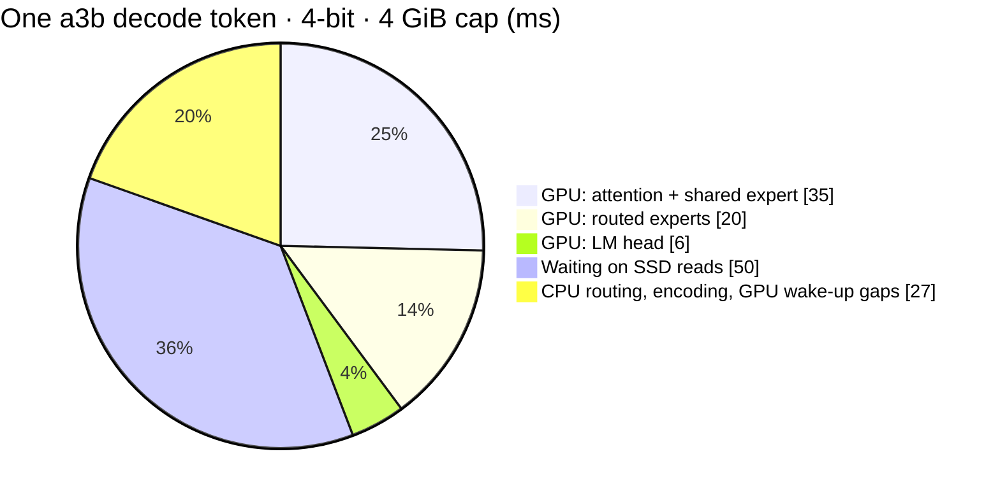

# Benchmarks

Detailed measurements behind the numbers in the [README](../README.md):
Qwen3.6-35B-A3B on a shared 18 GB M3 Pro, under memory caps of 3–6 GiB.
Ideas that were measured and did not pay off are in
[`known-issues.md`](known-issues.md).

## Test setup

Every number here and in the README comes from this setup unless its
*Setup* line says otherwise.

| | Standard setup |
| --- | --- |
| Host | MacBook Pro, M3 Pro (11-core CPU), 18 GB RAM, internal SSD; shared with other services, 7–10 GiB reclaimable during the runs |
| Model | Qwen3.6-35B-A3B from `mlx-community/Qwen3.6-35B-A3B-4bit`, converted as in [Setup](../README.md#setup); experts 4-bit (`root/`) or packed 3-bit (`root-3bit/`) |
| Engine | `tools/chat` release build, 2026-10-28 (prefill staging and scratch lent to the hot tier, hot-tier decay every 4096 picks); a fresh server per run, the KV cache reset between prompts |
| Settings | n_ctx 4096, F32 KV, cross-layer guess with 6 experts prefetched, `attn_threads` 4, vision on (its 0.13 GiB is in the plan), thinking off, greedy (temperature 0) |
| Prompts | *Photosynthesis* — "Explain photosynthesis to a ten-year-old in one paragraph." (120 tokens decoded) · *JavaScript* — "Write a JavaScript function that checks whether a string is a palindrome." (74) · *Hiking* — "Give me a short packing list for a weekend hiking trip." (120) |
| Reported | tok/s = decoded tokens ÷ decode time (the chat page's figure); hot-tier hits and disk MiB per decode token; first word = request to first streamed token; peak = process footprint. Each value is the mean of 2 runs (the runs agree within ±6%) |
| Units | GiB / MiB for memory and disk (1 GiB = 2³⁰ bytes); GB/s only for SSD bandwidth; the Mac's RAM as sold (18 GB) |

## Speed

*Setup: standard; caps 3–6 GiB.* tok/s per prompt (Photosynthesis /
JavaScript / Hiking) and over all three:

| Cap | Experts | Hot tier | tok/s per prompt | tok/s, all | Hot-tier hits | Disk MiB / token | First word | Peak |
| --- | --- | --- | --- | --- | --- | --- | --- | --- |
| 3 GiB | 4-bit | 0.05 GiB | 8.8 / 7.5 / 8.5 | **8.3** | 48 / 39 / 51% | 317 / 382 / 305 | 1.0–1.5 s | 2.64 GiB |
| 3 GiB | packed 3-bit | 0.14 GiB | 9.9 / 8.6 / 9.4 | **9.4** | 53 / 43 / 53% | 226 / 279 / 231 | 1.2–1.8 s | 2.61 GiB |
| 4 GiB | 4-bit | 1.05 GiB | 10.7 / 9.2 / 10.5 | **10.2** | 67 / 56 / 70% | 207 / 281 / 191 | 1.1–1.5 s | 3.65 GiB |
| 4 GiB | packed 3-bit | 1.14 GiB | 11.7 / 10.0 / 12.1 | **11.4** | 73 / 60 / 72% | 135 / 199 / 139 | 1.2–1.3 s | 3.61 GiB |
| 5 GiB | 4-bit | 2.05 GiB | 12.1 / 9.7 / 12.3 | **11.5** | 78 / 65 / 80% | 141 / 225 / 131 | 1.2–1.6 s | 4.64 GiB |
| 5 GiB | packed 3-bit | 2.14 GiB | 14.3 / 11.4 / 13.3 | **13.1** | 83 / 71 / 83% | 85 / 149 / 91 | 1.1–1.4 s | 4.62 GiB |
| 6 GiB | 4-bit | 3.05 GiB | 13.7 / 10.5 / 13.7 | **12.8** | 85 / 73 / 86% | 98 / 176 / 94 | 1.2–2.0 s | 5.65 GiB |
| 6 GiB | packed 3-bit | 3.14 GiB | 15.4 / 12.2 / 14.4 | **14.2** | 88 / 78 / 87% | 60 / 115 / 69 | 1.0–1.4 s | 5.62 GiB |

Hot tier is the planned size; during decode the lent prefill staging
and scratch add 375 slots (4-bit) or 424 (packed 3-bit).

How to read it:

- **Packed 3-bit is 11–14% faster at every cap**, and packed 3-bit at
  4 GiB is about as fast as 4-bit at 5 GiB. Quality against 4-bit: KL
  0.048, the same top token 93% of the time, perplexity 1.15 → 1.21,
  all 10 scored tasks right (JSON, tool calls, arithmetic, code).
- **Each extra GiB adds 8–23%**, most going from 3 to 4 GiB. The
  JavaScript prompt spreads over the most experts, so it reads the
  most from disk at every cap.
- **The hot tier at 3 GiB is nearly empty**, yet hits are 39–53%: the
  slots lent from the prefill staging and scratch during decode carry
  it.
- **The part of a token that is not disk wait is 51–72 ms** (forward
  time minus disk wait), and it falls as the cap grows: 62–72 ms at
  3 GiB, 51–58 ms at 6 GiB with packed 3-bit, since fewer misses
  means less CPU and GPU work around each read. With every expert in
  RAM — a ~16 GiB cap for packed 3-bit (13.1 GiB of experts), ~20 GiB
  for 4-bit — decode would reach roughly **18 tok/s** (*estimated, not
  measured*: this 18 GB host can't spare that much). A cap above what
  other programs leave free makes the machine swap and is slower than
  a small cap.
- **25–54% faster than the 2026-10-26 build** at the same caps, more
  at bigger caps (4 GiB: 7.4 → 10.2 tok/s 4-bit, 8.1 → 11.4 packed
  3-bit), on the same shared host with other apps running. It comes
  from the hot tier: forgetting old topics in ~13 tokens instead of
  ~205 and lending the idle prefill scratch as well as the staging
  (each measured on its own in [Prefetch and reuse](#prefetch-and-reuse)
  and [`known-issues.md`](known-issues.md)).
- First word is time to the first streamed token for a ~25-token
  prompt; the chat template plus a short question prefills slowly
  because each token picks new experts. Long prompts prefill far
  faster (135+ tok/s for a 3.3k-token prompt, measured on an earlier
  build).
- **Answers match MLX.** Output is identical across caps; with 4-bit
  experts, argmax equals the MLX reference and the top-20 overlap is
  20/20 with F32 KV and 19/20 with Turbo4 (the gate in
  `mlx_regression.rs` is 19). On a3b the KV cache is small (10
  full-attention layers, 2 KV heads), so F32 KV costs little and Turbo4
  gains nothing measurable.

### From an external SSD

*Setup: standard, except: model on a Kingston NV3 500 GB (QLC,
DRAM-less) in a USB4 enclosure, 4-bit experts, caps 7 and 9 GiB run
alternately back to back (7, 9, 7, 9 within three minutes),
2026-10-30, same engine build (no engine change since the 2026-10-28
build).* The drive reads 2.3 GB/s sequential and 2.6 GB/s for random
expert-sized (6.75 MiB) reads at queue depth 8, uncached (`fio`).

| Cap | Hot tier | tok/s per prompt | tok/s, all | Hot-tier hits | Disk MiB / token | Disk wait / token | First word | Peak |
| --- | --- | --- | --- | --- | --- | --- | --- | --- |
| 7 GiB | 4.05 GiB | 11.8 / 8.1 / 10.8 | **10.2** | 89 / 78 / 89% | 70 / 143 / 72 | 27 / 60 / 32 ms | 2.0–2.6 s | 6.63 GiB |
| 9 GiB | 6.05 GiB | 12.3 / 9.2 / 12.2 | **11.2** | 93 / 85 / 93% | 46 / 104 / 50 | 23 / 45 / 24 ms | 1.6–3.0 s | 8.65 GiB |

Runs in order of time, tok/s over all three prompts: 7 GiB 10.6,
9 GiB 11.7, 7 GiB 9.9, 9 GiB 10.7. The host's 1-minute load rose from
2.4 to 3.5 over the four runs, and each cap's second run was slower
than its first.

- **The 2 GiB larger cap is worth ~10%**: +4% on Photosynthesis,
  +13% on JavaScript, +12% on Hiking. With
  `STREAMMOE_GPU_TIMING` on, the GPU was busy 38–40 ms per token in
  every run; the difference is GPU idle time (43–53 ms per token at
  9 GiB, 53–61 ms at 7 GiB), almost all of it waiting at the expert
  step for reads the smaller hot tier misses.
- **Compare caps within this table, not with the one above.** A 7 GiB
  4-bit run from the internal SSD the same afternoon gave 9.5 tok/s
  (mean of 2) with about half the disk wait (20 ms per token for 25
  expert reads, against 40 ms for 24 here), but its forward time
  outside disk wait was ~86 ms against ~61 ms here (means over the
  three prompts). That day's
  differences outside the disk were larger than the external drive's
  cost.
- An earlier 7 GiB run from this drive (8.6 tok/s), started right
  after 32 GiB was copied onto it, is left out: a QLC drive keeps
  folding its write cache for minutes after a large write.

## Compared with MLX

*Setup: the standard host (M3 Pro, 18 GB, shared with other apps, 6.4 GiB
reclaimable at the start), Qwen3.6-35B-A3B from the same
`mlx-community/Qwen3.6-35B-A3B-4bit` files, the photosynthesis prompt,
greedy, 120 tokens max; MLX 0.32.4 with mlx-lm 0.32.2
(`mlx_lm generate`); 2026-10-28.*

| | streamoe, 4 GiB cap | MLX (no memory cap) |
| --- | --- | --- |
| Memory for the model | 3.6 GiB peak (the whole process) | 18,605 MB by mlx-lm's own estimate, above its recommended 12,288 MB on this Mac |
| Decode | 10.7 tok/s | ~3 tokens in 628 s (~0.005 tok/s), then stopped |
| Effect on the host | none: `F_NOCACHE` reads, inside the cap | swap 15.5 of 16 GB used; reclaimable memory 6.4 → 3.7 GiB |

MLX loads every weight into GPU memory, so on a Mac with less free
memory than the model it pages to swap and barely makes progress.
streamoe keeps 1.29 GiB of non-expert weights and a hot tier in RAM and
streams the rest. MLX would be the faster engine on a Mac with room for
the whole model; this compares what each does inside the memory a
shared 18 GB Mac can give. MLX was run once and stopped by hand: its
GPU memory does not show in the process's RSS, so the RSS guard used
for these runs could not stop it. llama.cpp was not measured (the
installed build predates Qwen3.6 support).

## Prefetch and reuse

*Setup: standard, 4-bit experts, 4 GiB cap; one setting changed per
row.*

| Setting | tok/s per prompt | tok/s, all | Hot-tier hits | Disk wait, ms / token | Prefetched experts used / token |
| --- | --- | --- | --- | --- | --- |
| **standard** (cross-layer guess, 6 prefetched) | 10.7 / 9.2 / 10.5 | **10.2** | 67 / 56 / 70% | 33 / 44 / 35 | 61 / 71 / 50 |
| previous-token guess, 4 prefetched (library default) | 9.6 / 7.7 / 9.7 | 9.1 | 67 / 56 / 70% | 50 / 64 / 49 | 7 / 8 / 5 |
| cross-layer guess, 4 prefetched | 10.2 / 8.4 / 10.4 | 9.8 | 67 / 56 / 70% | 37 / 51 / 36 | 43 / 46 / 32 |
| cross-layer guess, 8 prefetched | 10.0 / 8.5 / 10.5 | 9.8 | 67 / 56 / 70% | 39 / 51 / 35 | 76 / 91 / 65 |
| no lending at all (`STREAMMOE_HOT_LEND=0`) | 9.2 / 7.6 / 9.1 | 8.8 | 57 / 47 / 60% | 44 / 61 / 46 | 83 / 91 / 71 |
| staging lent, scratch not (`STREAMMOE_HOT_LEND_SCRATCH=0`) | 9.8 / 8.5 / 10.4 | 9.7 | 64 / 54 / 68% | 41 / 50 / 36 | 67 / 76 / 56 |
| old hot-tier decay, every 65536 picks (`STREAMMOE_HOT_DECAY=65536`) | 9.7 / 6.7 / 8.9 | 8.5 | 61 / 38 / 57% | 40 / 75 / 48 | 73 / 111 / 78 |
| no early hot experts (`STREAMMOE_EARLY_EXPERTS=0`) | 9.5 / 8.1 / 10.1 | 9.3 | 67 / 56 / 70% | 34 / 45 / 33 | 60 / 72 / 50 |

The standard row is the 2-run mean from [Speed](#speed); the others
are single runs (runs agree within ±6%). The cross-layer guess — the
next layer's experts guessed from the current hidden state, so their
reads start while the GPU is still busy — is 12% faster than the
library default (`PrefetchGuess::PrevToken`, 4 experts), and 6 is the
best width: 4 leaves reads for later, 8 reads more than it saves.
Lending the idle prefill buffers to the hot tier is worth 16% (5% of
it from the scratch). Forgetting old popularity within ~13 tokens
instead of ~205 is worth 20%, most on the JavaScript prompt (6.7 →
9.2 tok/s), whose experts differ most from the previous prompt's.
Dispatching hot experts before the disk reads land read 9% here with
the same disk wait, so most of that gap is run-to-run noise (it
measured 1–2% before). Output is identical in every row. More CPU threads did not help on an earlier build: `io_threads` 16
and `attn_threads` 8 match the defaults. On OLMoE-1B-7B the cross-layer
guess did not help.

## Several tokens per pass

`Ctx::eval_tokens` decodes up to 4 tokens of one sequence in one pass,
and `Ctx::eval_requests` decodes one token from each of up to 4
requests. Logits are bit-identical to one token per pass, and the extra
buffers are in the plan (`OpenConfig::max_decode_tokens`). A pass of 4
tokens costs ~3× one token here: disk reads are the union of the
tokens' experts, and every kernel still runs once per token.

*Setup: `batch_bench` — packed 3-bit experts, 6 GiB cap, n_ctx 2048,
otherwise standard settings, on the 2026-10-26 build (before the
2026-10-28 hot-tier changes); 4 requests from 4 short prompts (25–30
tokens), 64 tokens each; 3 runs.*

| Mode | Total tok/s | Per stream | vs one request at a time |
| --- | --- | --- | --- |
| one request at a time | 8.9 | 8.9 | 1.00× |
| batch 2 | 10.4–11.0 | 5.2–5.5 | 1.16–1.23× |
| batch 3 | 11.4–11.5 | 3.8–3.9 | 1.28–1.29× |
| batch 4 | **11.6–11.9** | 2.9–3.0 | **1.30–1.33×** |

Parallel decoding pays when several requests are waiting; each one gets
its tokens more slowly.

Speculative decoding with prompt-lookup drafts pays only on long
matches, so `spec_bench` drafts only when the match runs back at least
8 tokens. *Setup: `spec_bench`, 4 GiB cap, 128 tokens, 5 prompts (2
copy-heavy), 2 alternating rounds, 2026-10-28 build.* Speedup over plain
decode, guarded / unguarded:

| Prompt | Packed 3-bit | 4-bit |
| --- | --- | --- |
| Grammar fix | 0.95 / 0.85× | 1.00 / 0.91× |
| Docstrings | 1.02 / 0.92× | 1.00 / 0.88× |
| Photosynthesis (no drafts) | 1.12 / 1.10× | 1.12 / 1.00× |
| Repeat a paragraph, one word replaced | 1.17 / 1.24× | 1.24 / 1.26× |
| Rename a function in code | 1.19 / 1.12× | 1.26 / 1.14× |
| **All five** | **1.08 / 1.03×** | **1.12 / 1.02×** |

Outputs are token-identical to plain decode. The plain baseline mixes a
cold and a warm run, so a prompt with no drafts reads above 1.0×:
compare the two columns with each other. Details in
[`docs/known-issues.md`](known-issues.md).

## Where a decode token goes

*Setup: standard, 4-bit experts,
4 GiB cap, on the 2026-10-26 build (a token took 138 ms then, ~99 ms
on the 2026-10-28 build, mostly from less disk wait), mean over the
three test prompts, GPU timestamps (`STREAMMOE_GPU_TIMING`) and I/O
counters:*



The CPU uses ~0.7 of 11 cores while decoding, so the levers are fewer
bytes from disk and fewer, longer GPU bursts — not more threads. The
GPU kernels run 3–4× slower than the same kernels in isolation:
decode's short bursts leave the GPU in a slow state.

## Disk timeline

`STREAMMOE_IO_TRACE=<file>` records every expert read and the phase of
each layer; `tools/io_trace_report.py` turns it into disk busy / idle
time. *Setup: standard, packed 3-bit experts, 4 GiB cap, the
photosynthesis prompt, a 2026-10-26 build (before early expert
dispatch and the 2026-10-28 hot-tier changes); tracing adds ~15%, so read it for proportions, not
speed:*

```text
prefill, 40 layer stages: 1474 ms, staging 971 ms, GPU between stages 503 ms; 72.7 experts/layer, 4.1 GB/s while staging
decode, 120 tokens: 113.3 ms/token, disk busy 51.8 ms, idle 61.6 ms; 137 reads, 180 MiB per token
  phase       wall ms  busy ms  idle ms
  attention      80.5     29.4     51.1
  misses         24.3     22.4      2.0
  dispatch        8.5      0.0      8.5
```

Prefill staging runs at the SSD's limit (~4.1–4.6 GB/s here), and the
disk's idle time in decode comes in ~1 ms pieces too short to fill with
more prefetch.

## Vision

*Setup: standard, 4-bit experts, 4 GiB cap, one image per turn; measured when vision landed, on a 2026-10-26 build:*

| Image | Image tokens | Encode | Prefill (whole turn) | Process memory | CPU (peak, whole run) |
| --- | ---: | ---: | ---: | ---: | ---: |
| 448 × 320 | 140 | 1.1 s | 5.3 s | 3.69 GiB | ≤ 2.1 cores |
| 512 × 512 | 256 | 1.9 s | 5.7 s | 3.69 GiB | ≤ 2.1 cores |
| 640 × 640 (cap) | 400 | 3.2 s | 5.3 s | 3.71 GiB | ≤ 2.1 cores |

## Estimates

### Qwen3-30B-A3B

Qwen3-30B-A3B (the `qwen3_moe` architecture: 48 full-attention layers,
128 experts, top-8, no linear attention) is **not supported yet**: it
needs its own variant, likely closer to the OLMoE path than to the
Qwen3.6 one. Estimated from its shape, not measured: ~15 GiB of 4-bit
experts at ~2.5 MiB each, ~0.95 GiB read per token with a cold hot tier —
about twice Qwen3.6-35B-A3B — and 192 KiB of F32 KV per token
(0.75 GiB at n_ctx 4096, ~0.1 GiB with Turbo4), so it would decode
slower than Qwen3.6-35B-A3B at the same cap and gain more from a
quantized `kv_format`.
