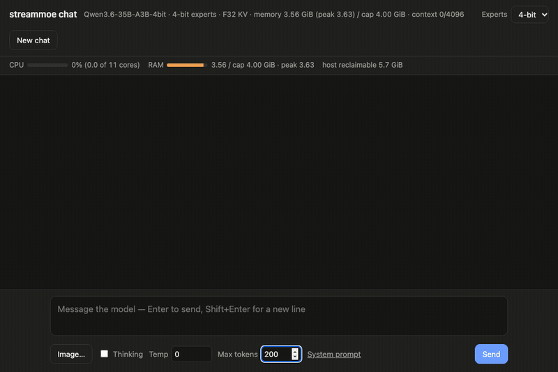
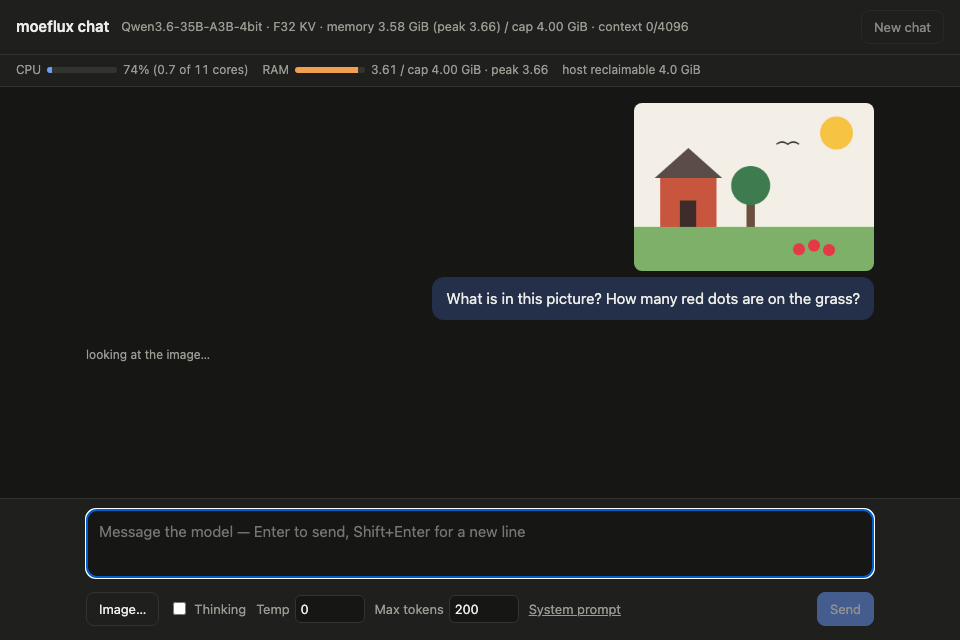
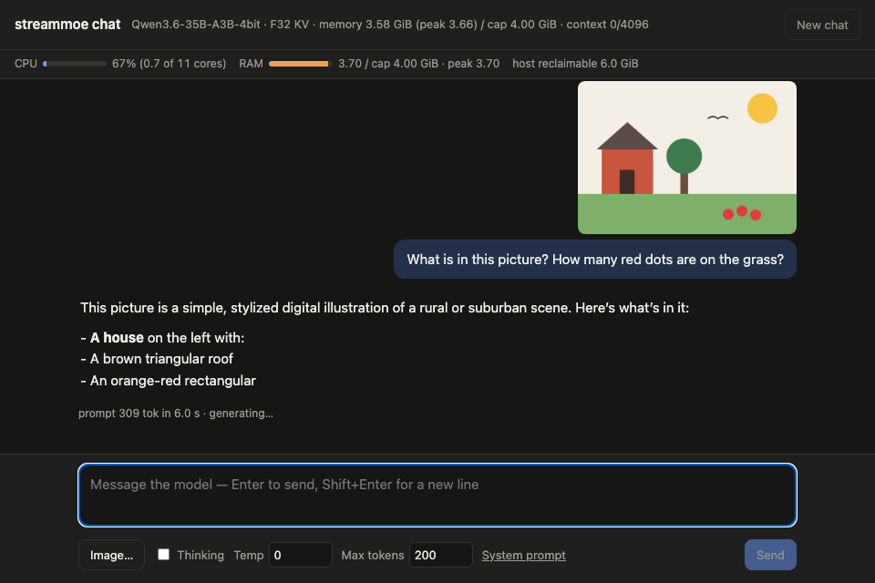
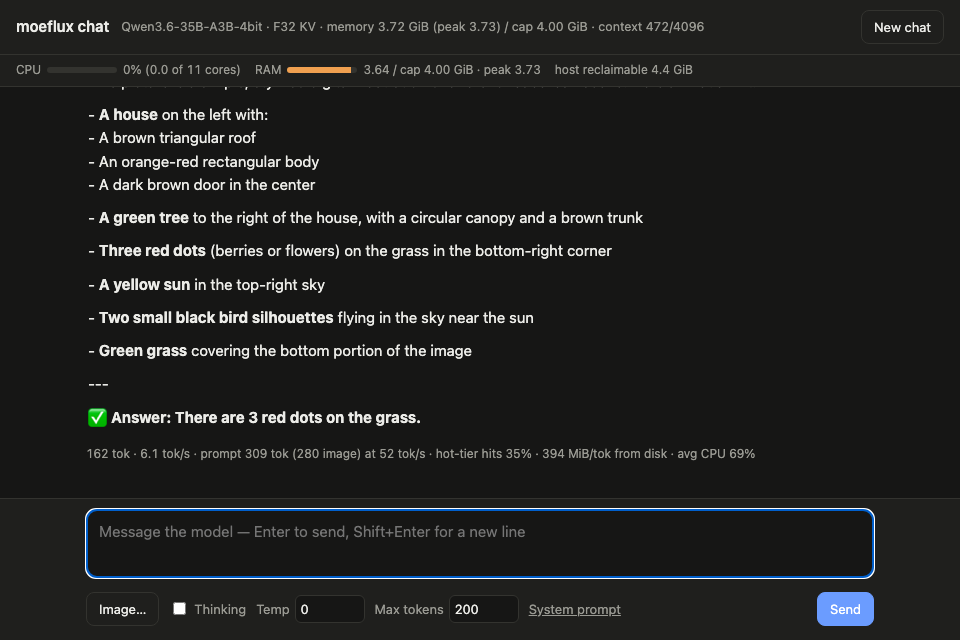

# Chat page

`tools/chat` is a local chat page for trying Qwen3.6-35B-A3B under a
memory cap (standalone crate; the engine gains no dependencies). Setup
of the model files is in the [README](../README.md#running-qwen36-35b-a3b-on-a-small-mac).

```bash
cd tools/chat
cargo run --release -- --cap-gib 4 --n-ctx 8192
# options: --kv f32|f16|turbo4, --attn-threads N, --guess cross|prev, --prefetch N,
#          --precision 4|3 (3 needs $M/root-3bit, see Setup),
#          --max-chats 1..4 (chats served at once, see below),
#          --spec (speculative decoding for greedy answers, see below)
#          --no-prefill-while-typing, --draft-chunk N (see below)
# open http://127.0.0.1:8077
```

It listens on 127.0.0.1 only and keeps one conversation in the KV
cache (or several: [`--max-chats`](#several-chats-at-once)), so each
message prefills only the new text. The header shows
memory against the cap and the context used; each answer shows tok/s,
prefill speed, hot-tier hits and disk MiB per token. Thinking can be
toggled. An **Experts** selector in the header switches between 4-bit
and packed 3-bit experts (the server restarts itself in ~2 s and frees
the old model first, so memory stays under the cap). Its defaults are
the [standard setup](benchmarks.md#test-setup) with 4-bit experts:
10.2 tok/s over the three test prompts at a 4 GiB cap. Stop the server
(Ctrl-C) to give the memory back.

A bar under the header shows the process's CPU (as cores used), its
memory against the cap with the peak, and the host's reclaimable
memory, sampled every second; it keeps updating while an answer is
generated. Each answer also reports its average CPU.

## What it looks like

*Setup: standard, 4-bit experts, 4 GiB cap, 2026-10-28 build, recorded
with headless Chrome on a shared M3 Pro with other apps running.* Real
time — the GIFs are not sped up.

**Text** — 8.9 tok/s, 3.65 GiB of the 4 GiB cap:

<p align="center"></p>

```text
58 tok · 8.9 tok/s · prompt 39 tok at 18 tok/s · hot-tier hits 62% · 238 MiB/tok from disk · avg CPU 48%
```

**Image** — 280 image tokens encoded in 1.7 s, the 309-token prompt
read in 6.4 s, then 9.6 tok/s at a 3.68 GiB peak. Each stage shows in
the page as it happens:

| 1 · Vision encoder running | 2 · Answer streaming | 3 · Done, with the turn's stats |
| :---: | :---: | :---: |
|  |  |  |

```text
162 tok · 9.6 tok/s · prompt 309 tok (280 image) at 49 tok/s · hot-tier hits 63% · 232 MiB/tok from disk · avg CPU 62%
```

The image is a drawing made for this demo (house, tree, sun, one bird
and three red dots). The model names the house, tree and sun, counts
the three dots correctly, and reads the single bird as two. On the
2026-10-26 build the same two turns ran at 6.7 and 5.9 tok/s with the
same answers.

## Images

With `artifacts/vision_weights.bin` exported, an *Image…* button
appears (paste works too). The page resizes the picture so both sides
are multiples of 32 and the area is at most `--vision-max-pixels`
(default 640 × 640 = 400 image tokens); the CPU vision encoder
(`streammoe::riir::vision`, Accelerate GEMMs, `--vision-threads`
default 4) turns it into embeddings, and the model reads them at their
M-RoPE positions (`Ctx::eval_stage_mrope`). The encoder streams its
0.85 GiB of BF16 weights from disk for each image and keeps 137 MiB of
buffers, counted in the cap (`OpenConfig::host_buffers`). `--no-vision`
turns it off. Encoding a 640 × 640 image (400 tokens) takes ~3 s and
the process stays at ~3.7 GiB under a 4 GiB cap
([timings](benchmarks.md#vision)).

Decode after an image runs at the usual speed. Scenes, colors, layout
and counting work (a 2 × 2 color grid, five dots, shapes and their
positions, a photo); reading small or short printed text is
unreliable. MLX makes the same mistakes when given the same image
embeddings (see [`known-issues.md`](known-issues.md)), so this comes
from the model, not the engine. Larger images help: "7780" read
correctly at 640 × 320 and not at 512 × 256.

## Several chats at once

`--max-chats N` (2–4; default 1) serves N conversations at once, for
several people or tabs. Each page load gets its own session id and,
with its first message, a request slot: a KV cache and linear-attention
state of its own (`OpenConfig::max_requests`), kept between turns so
each message still prefills only the new text. One engine thread
schedules them: between decode steps it answers requests and prefills
new turns (the other answers pause meanwhile), then decodes one token
of every running answer in a single `Ctx::eval_requests` pass and
streams each to its own page. A turn that finds all N chats answering
waits until one ends (the page shows *waiting*). When every slot holds
a conversation, a new tab takes the one idle longest; that
conversation's next message gets an error asking for New chat. Each
answer shows its own tok/s and how many chats decoded with it;
hot-tier hits and disk MiB per token count every chat's tokens.
Images need `--max-chats 1` (the vision encoder is not loaded
otherwise). With `--max-chats 1` nothing changes: same engine calls,
same numbers.

Each answer is token for token what it would be alone
(`python3 tools/chat/multi_chat_check.py --port 8077` checks a running
server: the prompts one at a time, then all at once). Under a cap the
extra chats cost hot tier: every slot plans its KV (`n_ctx` × 40 KiB
at F32, 0.16 GiB at n_ctx 4096) and 0.12 GiB of linear-attention
state, plus 0.06–0.22 GiB of multi-token pass buffers, and the hot
tier gets what is left.

*Setup: standard (n_ctx 4096, greedy, thinking off), 6 GiB cap,
2026-11-05 build; a fresh server with `--max-chats N` per run; N of
four prompts (the three test prompts plus "What are the main
differences between TCP and UDP? Answer in a few sentences.") sent at
once, 120 tokens at most. Total tok/s = every chat's tokens ÷ wall time
from the first request to the last answer, prefills included; the
baseline is a `--max-chats 1` server answering the same prompts one
after another. Two runs (run 1 / run 2).*

| Experts | Chats | Hot tier | Total tok/s | One at a time | Ratio | Per chat (mean) | Hot-tier hits | Peak |
| --- | --- | --- | --- | --- | --- | --- | --- | --- |
| 4-bit | 1 | 3.05 GiB | 9.9 / 10.2 | — | — | 11.5 / 11.9 | 73–86% | 5.65 GiB |
| 4-bit | 2 | 2.84 GiB | 9.1 / 9.8 | 9.3 / 9.5 | 0.98 / 1.03× | 5.7 / 6.1 | 68–72% | 5.65 GiB |
| 4-bit | 3 | 2.49 GiB | 9.7 / 8.9 | 10.0 / 10.2 | 0.96 / 0.87× | 3.8 / 3.5 | 62–67% | 5.67 GiB |
| 4-bit | 4 | 2.13 GiB | 9.3 / 9.3 | 9.9 / 10.2 | 0.94 / 0.91× | 2.8 / 2.8 | 55–59% | 5.65 GiB |
| packed 3-bit | 1 | 3.14 GiB | 12.0 / 11.8 | — | — | 13.8 / 13.6 | 78–88% | 5.61 GiB |
| packed 3-bit | 2 | 2.94 GiB | 11.7 / 11.8 | 12.0 / 11.9 | 0.98 / 0.99× | 7.3 / 7.4 | 75–77% | 5.63 GiB |
| packed 3-bit | 3 | 2.58 GiB | 12.0 / 11.0 | 12.2 / 12.1 | 0.99 / 0.91× | 4.8 / 4.4 | 69–72% | 5.63 GiB |
| packed 3-bit | 4 | 2.22 GiB | 11.0 / 10.8 | 12.0 / 11.8 | 0.92 / 0.92× | 3.4 / 3.3 | 63–66% | 5.62 GiB |

Every answer matched its one-at-a-time answer in every run. At this
cap serving chats together does not raise total throughput: it stays
at 0.87–1.03× of answering them one after another. The pass does save
GPU work, but two things cancel it. Concurrent conversations need the
union of their experts, so hot-tier hits fall (85% → 59% on the first
prompt at 4 chats, 4-bit), and the extra slots shrink the tier. On
their own, the extra slots cost ~8%: a `--max-chats 4` server
answering the four prompts one at a time gave 11.0 tok/s (packed
3-bit), against 12.0 with `--max-chats 1` and 11.0 with all four at
once. What it gives is fairness, not speed: everyone sees their
answer stream from the start, at a share of the speed, instead of
waiting for the earlier answers to finish. A bigger cap, a smaller
`--n-ctx` or `--kv f16` leave more for the hot tier.
`batch_bench`, which decodes from saved states with the tier warmed,
measured 1.14 / 1.00 / 1.02× for 2 / 3 / 4 requests at 6 GiB (4-bit,
120 tokens, same build).

## Speculative decoding (`--spec`)

`--spec` (off by default) turns on prompt-lookup speculative decoding
for greedy answers (temperature 0). Before each decode step the server
looks the last 3 (then 2) tokens up earlier in the conversation; when
that match runs back at least 8 tokens (`--spec-min-match N`), it
evaluates the sampled token and up to three tokens that followed the
match in one `Ctx::eval_tokens` pass, keeps the drafts the model
agrees with and undoes the rest with `Ctx::rewind_tokens`. The answer
is token for token the plain greedy one. The drafting code is shared
with `spec_bench` (`tools/chat/src/lookup.rs`). The `[chat]` stats line
and the `done` event gain `spec`: verify passes, plain steps, tokens
drafted and accepted. It is off for a turn that samples (temperature
above 0), for a conversation with an image in it, and with
`--max-chats` > 1; each case is logged.

It pays only when the answer copies text that is already in the
conversation (edit this code, fix this text, repeat with a change).
On ordinary chat the 8-token guard almost never drafts, so speed is
that of plain decode minus the pass buffers' share of the cap: the
4-token pass (`OpenConfig::max_decode_tokens` 4) takes 132 experts'
worth of hot tier (1012 → 880 slots at 4 GiB), so hot-tier hits drop
~3 points and disk reads per token rise ~6–10%.

*Setup: standard (n_ctx 4096, F32 KV, greedy, thinking off), 4-bit
experts, 120 tokens at most, 2026-11-05 build; a fresh server per run,
off and on alternating. "Test prompts" is the three test prompts
together; the copy prompt asks to repeat a 15-line Python snippet with
one function renamed.*

| Cap | Test prompts, off | Test prompts, `--spec` | Copy prompt, off | Copy prompt, `--spec` | Copy drafts accepted |
| --- | --- | --- | --- | --- | --- |
| 4 GiB | 10.6 / 11.3 tok/s | 11.2 / 9.9 tok/s | 8.3 / 8.0 tok/s | 9.3 / 9.2 tok/s (1.14×) | 60 / 60 |
| 6 GiB | 15.4 / 14.7 tok/s | 15.1 / 14.9 tok/s | 10.3 / 10.6 tok/s | 11.7 / 11.9 tok/s (1.13×) | 60 / 60 |

Every answer matched the plain answer in every run. On the test
prompts `--spec` drafted nothing and was within run-to-run noise of
plain decode (−4% at 4 GiB, −1% at 6 GiB on the means, smaller than
the spread between runs); on the copy prompt it took 20 verify passes,
accepted every draft and was 1.13–1.14× faster. Keep it off unless the
chats are mostly edits of pasted text.
## Prefill while typing

Prefill while typing (on by default since 2026-11-05 with `--max-chats 1`;
`--no-prefill-while-typing` turns it off) uses the
time you spend typing to read the message, so the answer starts sooner
after Enter. A **Prefill while typing** checkbox appears next to
*Thinking* (on by default when the server has the flag). About 300 ms
after each keystroke the page posts the message box to `/draft`. The
server works out the tokens the turn will start with: the last turn's
`<|im_end|>`, the user header, and the draft up to the start of its
last word (a word still being typed can still change its tokens). It
prefills them on the engine's normal prefill path between requests, at
most `--draft-chunk` tokens (default 16) per step, so a `/chat` or a
newer draft waits at most one step. On Enter, if the prefilled tokens
are a prefix of the turn's real prompt, only the rest is prefilled: the
last word and the closing template.

Editing text that was already prefilled (backspace, a pasted
correction, a changed system prompt) needs a rollback. The KV cache can
be cut back, but the linear-attention recurrence cannot (see
[`known-issues.md`](known-issues.md)). So the first draft step of a turn
saves a checkpoint of the conversation (`Ctx::checkpoint_pos`), and an
edit restores it (`Ctx::restore_to`) and prefills again. In the first
turn there is nothing to save and a rollback clears the context. The
server opens with one checkpoint buffer planned under the cap
(`max_checkpoints: 1`), sized for a snapshot at the full `n_ctx`. The
hot tier gives up the room: at n_ctx 4096, F32 KV and a 4 GiB cap it
holds 880 experts instead of 1012 (0.22 GiB less). If the open fails with it, the server logs that and opens
without the feature. An image turn reads no draft (the page sends none
while an image is attached, and the server rolls back any).

The answer is the same token for token with the feature on or off:
the same tokens are evaluated, only in other chunks, and every step
has at least two tokens so it takes the batched prefill path like the
turn's own prefill. `python3 tools/chat/typing_check.py out.json --port
8077` types the three test prompts into a running server as one
conversation, the way the page does (a keystroke every 0.12–0.26 s, a
pause after each word, the 300 ms debounce, Enter 0.25 s after the last
key). Part way through each prompt it deletes the last ~15 characters,
which were already prefilled, and types them again, so every turn rolls
back once: to an empty context in the first turn and to the checkpoint
in the other two. `--compare` checks the answers of several runs
against each other.

*Setup: Qwen3.6-35B-A3B, 4-bit experts, 4 GiB cap, n_ctx 4096, F32 KV,
greedy, thinking off, 120 tokens at most, 2026-11-05 build; the three
test prompts as one conversation, typed by `typing_check.py`; a fresh
server per run, two runs per setting (run 1 / run 2). First word is
timed from Enter.*

| Prefill while typing | First word, prompts 1 / 2 / 3 | Prompt tokens read while typing | Decode tok/s | Hot-tier hits |
| --- | --- | --- | --- | --- |
| off | 1.19 / 1.07 / 1.08 s · 1.20 / 1.09 / 1.11 s | — | 10.1–12.2 | 57–71% |
| on | 0.79 / 0.73 / 0.82 s · 0.79 / 0.71 / 0.77 s | 12 of 25 / 15 of 27 / 13 of 26 | 9.9–11.8 | 56–69% |

Every answer was the same in all four runs. The first word comes 0.34 s
sooner on average (1.12 → 0.77 s, −31%). On this model the rest of the
prompt still costs most of a prefill pass: the closing template alone
is 9 tokens, and a short pass costs nearly as much as a long one, since
each layer's experts are read either way. The smaller hot tier costs
1–3 points of hits and up to ~4% of decode speed. The gain should be
larger where prefill is slow per token, such as Qwen3.5-397B-A17B at
~1 tok/s. Measured there (9 GiB cap, same prompts and tool, 32 tokens,
2026-11-05): the first word of prompts 2 and 3 came at 13.9 / 14.5 s
instead of 20.9 / 20.8 s (−32%), with 13–14 of 26–27 prompt tokens read
while typing; prompt 1 gained nothing, as its draft prefill was still
running at Enter. Decode speed was unchanged (0.53–0.59 tok/s).
